<div align="center">

# UnityMapper

### One prompt. One room.

An AI agent that builds, inspects and corrects furnished 3D rooms inside a real Unity HDRP project, using **Muse Spark** and **SAM 3.1**.


<a href="https://www.youtube.com/watch?v=kZxCXbrVMiw">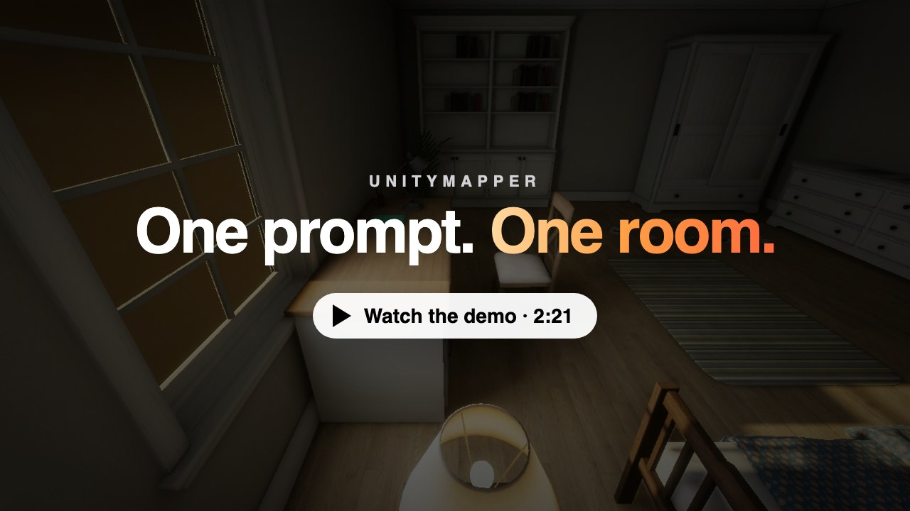</a>

<sub>Click to watch the 2-minute demo. Every frame is a real Unity render; no furniture was placed by hand.</sub>

</div>

---

## What it does

Describe a room, or attach a reference image. UnityMapper picks prefabs from your project's own catalogue, plans functional zones, builds the room natively in Unity HDRP zone by zone, inspects its own renders, corrects what's wrong, and reports what it still couldn't do.

A Go chat application talks to a Python execution service, which drives a Unity editor package. Muse Spark plans and judges; SAM 3.1 checks what was actually rendered.

<p align="center">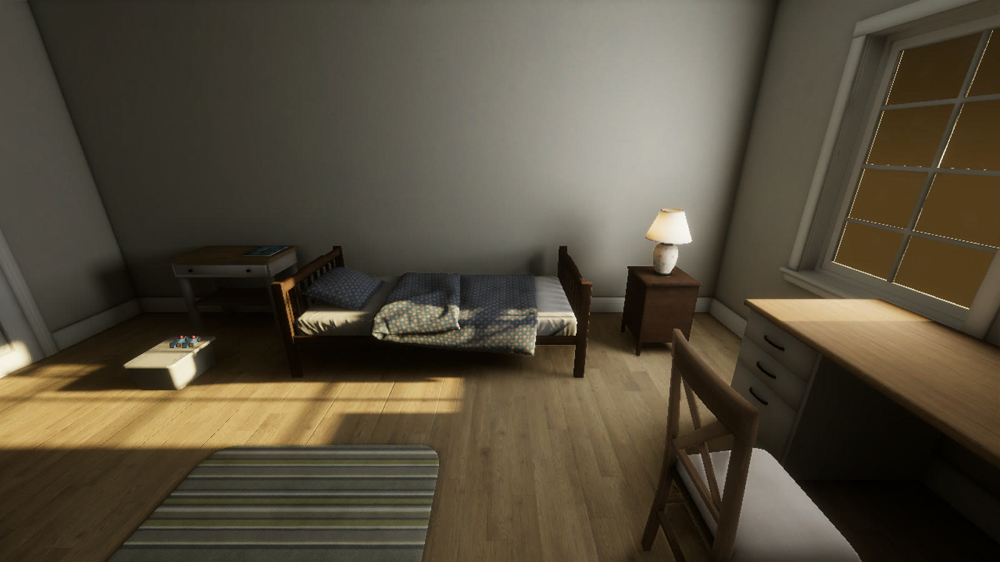</p>

## How it works

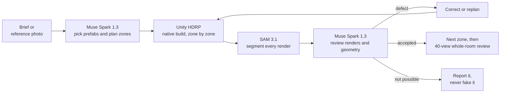

1. **Plan:** Muse Spark reads the brief and the asset catalogue page by page, keeps or drops each prefab with a written reason, and turns the brief into functional zones with anchors and orientations.
2. **Build:** a geometry solver places whole prefabs at native scale, checking support, collisions, door swing and circulation. Meshes are never stretched and assets are never invented.
3. **Inspect:** Unity renders interior viewpoints after every zone. SAM 3.1 segments each expected object by name, and Muse Spark reviews the images together with the native geometry.
4. **Correct:** failed candidates are rejected, improvements are kept, and a correction that can't be executed triggers targeted replanning.
5. **Report:** anything the available assets can't achieve is listed as unresolved.

Every call goes through the Meta Responses API with a strict JSON schema. Results are validated before Unity is touched, and a local ledger reserves budget before each request.

## Demo: a child's bedroom from one prompt

<p align="center">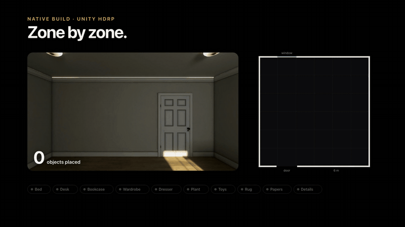</p>

| | |
|---|---|
| Room | 6 × 6 m child's bedroom, from a single 1,703-character brief |
| Objects | 30 prefabs at native scale, 30/30 correctly supported |
| Zones | 9 built, inspected and accepted (bed, desk, bookcase, wardrobe, dresser, plant, toys, rug, papers) |
| Iterations | 21 Unity scenes, rejected candidates included |
| Inspection | 40 viewpoints per whole-room review, 517 SAM-segmented views |

<details>
<summary><b>The exact prompt</b></summary>

> Create a complete, richly detailed and believable child's bedroom, 6 by 6 metres, using whole project prefabs at native scale. Aim for the coherent inhabited quality and soft baked daytime lighting of Assets/AtmosphericHouse/Scenes/House_clean_day.unity, not a sparse furniture showroom. Use a calm, warm, coordinated palette in interior style B. Plan a single bed with an accessible bedside table close to the head of the bed and a correctly supported bedside lamp; clothes storage; a drawing desk near daylight with a chair facing its work surface; a stocked bookcase with several purposeful book clusters; a rug if a suitable native prefab is available; small personal possessions, drawing materials, storage boxes, toys and a plant where appropriate and actually supported. Arrange details into believable lived-in zones with intentional asymmetry, not isolated objects scattered in the room. Use available approved supports and catalogue assets rather than inventing unavailable assets or stretching meshes. Keep the entrance, door swing, bed access and routes to the desk and wardrobe clear. No adult sofa, unrelated coffee table, floating props, intersecting furniture or objects in doorways. Build and inspect zone by zone, then review the entire room from multiple interior viewpoints. Correct observable placement, orientation, support and composition defects autonomously. Add meaningful detail to sparse approved surfaces while preserving circulation. Keep walls and ceiling closed, use motivated daylight and coherent practical fixtures, and verify the baked result. Do not declare success from a partial zone or from a bake receipt alone; report any unresolved quality limitation honestly.

</details>

### It looks: SAM 3.1 inspection

Each render is segmented by object name ("bed", "desk", "rug"…). The masks are compared with the bounds Unity projects for each object.

<p align="center">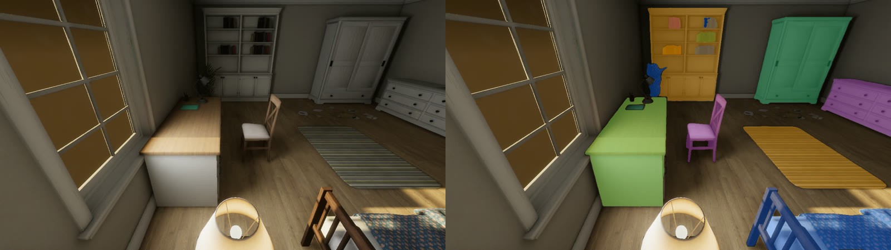</p>
<p align="center">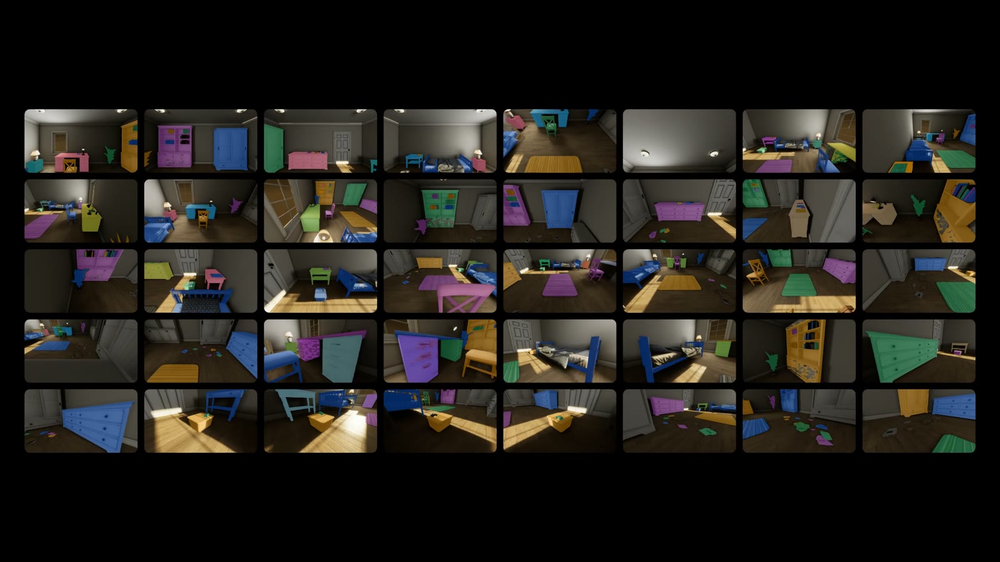</p>

### It corrects itself

Real log lines from the run: a failed whole-room review, a rejected candidate, an improvement that was kept, and a defect that was fixed.

<p align="center">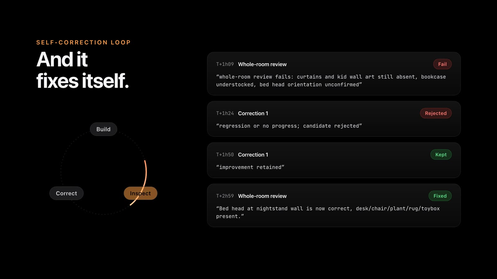</p>

### The room

<p align="center">
  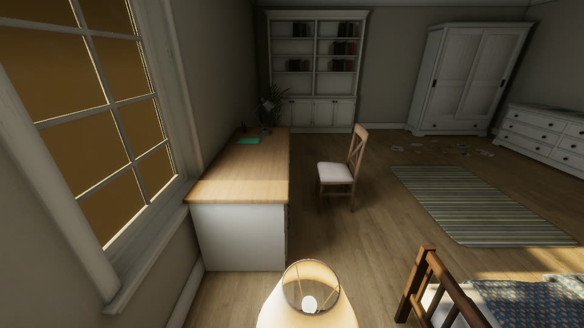
  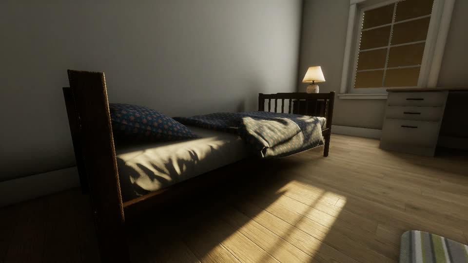
  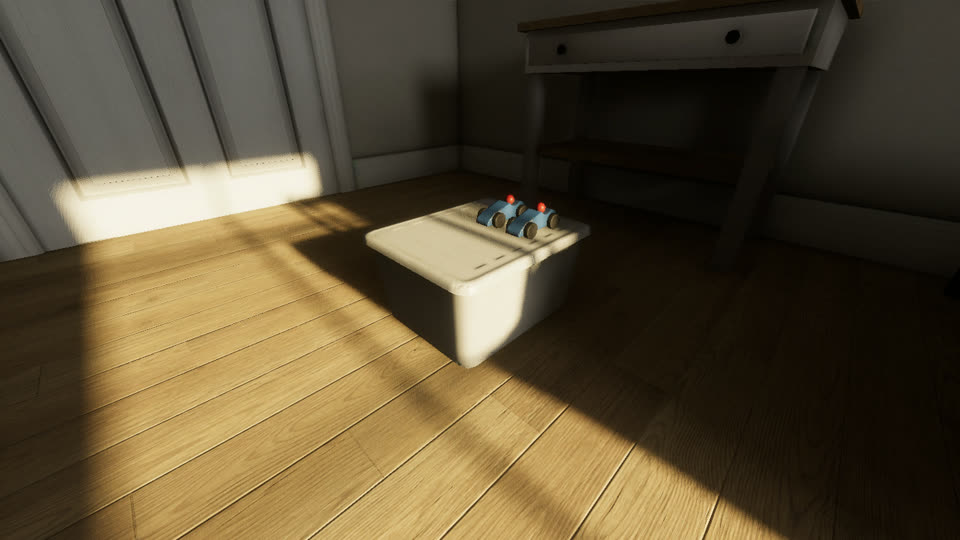
  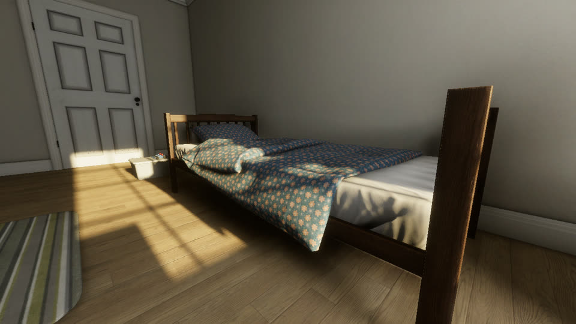
</p>

### And it says what's missing

Rather than faking a curtain, the agent reported: *"No supported window/wall mounting control available, cannot invent curtain asset."*

<p align="center">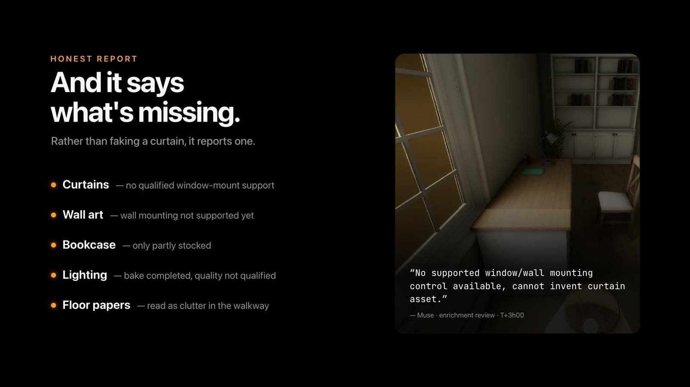</p>

> **Transparency.** The demo is a development run. Operator-assisted service fixes and recoveries happened during it, so it is not an uninterrupted autonomous benchmark. The room is a work in progress: curtains and wall art are missing (wall and window mounting isn't supported yet), the bookcase is only partly stocked, and baked-lighting quality is not yet qualified.

## Built with Meta models

| Model | Role |
|---|---|
| **Muse Spark 1.3** | Brief outline, catalogue review, asset orientation from preview renders, layout and repairs, lighting intent, zone and whole-room visual inspection, correction and enrichment proposals, project chat. One multimodal call per decision (text plus up to 12 images) with strict JSON-schema output. |
| **SAM 3.1** | Concept-prompted segmentation of every rendered view, with one-bit masks and confidence scores. Results are cached by image hash and concept and are never re-sent; masks appear as overlays in the live inspector. |

Both models are called through the Meta Responses API (`api.meta.ai/v1/responses`) via a reviewed allow-list of models, fields and image counts.

## Current capabilities

- Project-scoped conversations, SQLite history, and PNG/JPEG references.
- House generation from a brief and the legacy reference-reconstruction workflow.
- Native prefab placement, support and circulation checks, and progressive zone inspection.
- Live Unity inspection streams, saved captures, and actual SAM mask overlays.
- Persistent Markdown memory and targeted replanning when a correction cannot be executed.
- Native lighting-reference data exported from `House_clean_day.unity`.

Exact reconstruction fidelity and artistic quality are not guaranteed. Passing geometric checks does not establish a faithful or finished render. Automated baking, some asset replacement and wall-mounting operations, and visual catalogue browsing remain incomplete. The full progressive Unity/SAM/Muse workflow still needs release qualification.

## Plans and implementation status

- [Specification](specs/003-hdrp-scene-agent/spec.md)
- [Main plan](specs/003-hdrp-scene-agent/plan.md)
- [House generation plan](specs/003-hdrp-scene-agent/house-plan.md)
- [Go application and project chat](specs/003-hdrp-scene-agent/chat-plan.md)
- [Tasks](specs/003-hdrp-scene-agent/tasks.md)
- [Implementation status and limitations](specs/003-hdrp-scene-agent/implementation-status.md)

## Setup

The current validation environment uses macOS on Apple Silicon, Unity **6000.3.23f1**, HDRP **17.3.0**, Python 3.12, `uv`, FFmpeg, and Go 1.27.3.

```sh
uv sync --locked
cp .env.example .env
# Set the API key in .env, never in source files or the browser.
.venv/bin/hdrp-agent --env-file .env serve --provider-mode live
```

Open `unity/HDRPValidation` in Unity. The local package is in `unity/Packages/com.hackathon.hdrp-agent`. Two third-party asset packs are required, and their models and textures are not included in this repository:

- **AtmosphericHouse**, under `Assets/AtmosphericHouse`. The `gp.unity` scene and the referenced prefabs require it.
- **HouseProps 2**, under `Assets/HouseProps`. Import `HouseProps2_HDRP.unitypackage` through *Assets → Import Package → Custom Package*. The furniture and prop catalogue (`HouseProps/…` prefabs) comes from this pack.

See the [backend quickstart](specs/003-hdrp-scene-agent/quickstart.md) for budget setup, capabilities, and validation procedures. Never reset the global local ledger on startup. This repository contains no API keys, private balances, or local run captures, apart from the demo images in `docs/media`.

## Local chat

From the repository root:

```sh
./scripts/run-chat.sh
```

The launcher reuses an existing Python service or starts one, builds the Go application, and opens an authenticated local browser session. In Unity, enable **Window → HDRP Agent → Connect Local Service**. Select the project, describe a scene, and optionally attach PNG/JPEG references.

Conversations survive restarts. Unknown deliveries are never replayed automatically. Costs use the existing Python ledger; the chat has an initial 2 USD allowance within the shared budget. Generation actions use their own existing budget admission checks. Ctrl+C closes Go and only the backend started by this launcher.

The interface accepts up to three images of 10 MB each. Action status is polled every two seconds. The visual inspector streams the camera while Unity is rendering and keeps saved captures and segmentation evidence. A started or completed action is not proof of fidelity or artistic acceptance.

See [chat-quickstart.md](specs/003-hdrp-scene-agent/chat-quickstart.md) for validation scenarios and limitations.

## Exporting a run for presentation

```sh
# Evidence gallery: original renders, SAM overlays, montages, live segments, manifest
.venv/bin/python scripts/export_house_demo.py <run-id> --output .hdrp-agent/reports/<name>

# Captioned and clean presentation clips from the accepted construction stages
.venv/bin/python scripts/prepare_house_presentation.py <run-id> --output .hdrp-agent/reports/<name>
```

Both scripts read the local `.hdrp-agent` state and write to the ignored reports folder. Intermediate and rejected candidates stay in the full gallery, labelled as such.

## Verification

```sh
.venv/bin/pytest -q
cd apps/unitymapper
go test ./...
```

Unity tests use the Test Runner and the package validation bridge. Local evidence is written to `.hdrp-agent/reports/`, which Git ignores. Experimental scenes under `Assets/AgentWorkspace` and Unity caches are also excluded.

The [direct visual interaction experiment](specs/003-hdrp-scene-agent/direct-interaction-experiment.md) tests model-directed camera observations, exact prefab moves and undo on a persistent copy of a generated desk/seating arrangement. It remains separate from normal chat generation.
