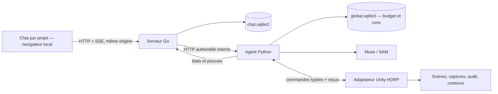

# Plan — application UnityMapper en Go et finitions de pièce

Date : 2026-10-31. Source : US10–US13 et CA-01–CA-10 de [spec.md](spec.md). Git : `main`, dépôt SSH fourni par l’utilisateur. État : conception ; Go installé, application non implémentée. Les corrections Unity en cours ne valent pas validation du futur chat.

## Architecture et responsabilités



Go porte le produit : projets, conversations, fichiers, UI, historique, événements et suivi des opérations. Python reste propriétaire des appels modèles, des réservations financières, des reconstructions et des identités natives. Unity reste seul auteur de mutations de scène sur son thread d’éditeur. Go ne lit ni n’écrit directement `global.sqlite3` et n’appelle pas Meta en parallèle du fournisseur Python.

## Contexte technique

- Go 1.27.3 observé localement ; `net/http`, `embed`, `database/sql`, `encoding/json`, `context`. UI HTML/CSS/JS embarquée : pas de serveur frontend séparé dans le MVP.
- SQLite applicatif distinct via `modernc.org/sqlite` ; version exacte et somme verrouillées dans `go.mod`/`go.sum` à T157, puis qualification sur Apple Silicon. Pas d’ORM ni d’infrastructure distribuée.
- Python 3.12, FastAPI, workers, ledger et adaptateur Muse/SAM existants conservés. Nouveaux endpoints et schémas propres au chat.
- Une instance Go loopback `127.0.0.1:8787`, Python existant `127.0.0.1:8765`. Workspace configuré explicitement et transmis au pont, sans supposer `../../` depuis Assets.
- Stockage Go `.hdrp-agent/chat/chat.sqlite3`, médias adressés par hash, état ignoré dans Git. Sources sous `apps/unitymapper/`.
- Deux projets peuvent être consultés ; exécutions Unity sérialisées, visibles comme attente. Le premier E2E utilise HDRPValidation. Aucun support universel implicite.

## Déficits actuels à traiter avant l’interface d’action

`api.py` ne fournit ni conversations, ni liste de projets, ni lancement HTTP de reconstruction. `ReferenceWorker` découvre les bundles que `ReferenceWorkflow.Begin` prépare dans Unity. Mettre un chat devant `/v1/sessions` ne suffit pas : ces sessions concernent le workflow existant, pas tout le parcours de reconstruction.

La préparation du bundle et le run doivent appartenir à la même opération réservée. L’index SQLite de session active interdit de réserver une session « commande » puis une autre « reconstruction ». Concevoir une admission unique avec adoption du session_id, persistance du command_id et du run_id ; ne pas supprimer l’exclusion mutuelle.

L’API Python refuse les Origin navigateur. Conserver cette frontière : le navigateur parle à Go ; Go ajoute le jeton interne côté serveur. Authentification locale Go avec cookie HttpOnly SameSite strict, bootstrap à usage unique, validation Host/Origin et requêtes mutantes protégées. Aucune exposition réseau publique par défaut.

## Parcours agent

1. Le créateur sélectionne un projet vérifié et ouvre une conversation ; l’app montre connexion Unity, scène et budget réels.
2. Message et pièces jointes sont enregistrés durablement avant la requête ; idempotency_key unique, historique borné et références de preuves.
3. Python demande à Muse une réponse structurée : texte et zéro ou plusieurs outils admissibles. Un appel payé, pas une boucle opaque de retry.
4. Le contrôleur valide droits de projet, état, version, arguments, budget et limites ; exécute séquentiellement les outils autorisés par le brief.
5. Les résultats natifs et les preuves alimentent le tour suivant. Maximum initial : 4 outils / tour, 6 tours d’outil, 40 minutes pour une reconstruction ; arrêt borné et visible. Les plafonds sont configurés avant exécution.
6. Le chat affiche les événements réels, les versions testées/rejetées, les captures et les incertitudes. Le texte du modèle ne peut pas fabriquer un statut « exécuté ».

Une demande floue ne doit pas choisir silencieusement une autre scène ou écraser un travail. Clarification pour information indispensable ; pas de confirmation répétée des réglages déjà autorisés. Une nouvelle mutation de scène pendant un run attend l’arrêt ; un simple message de discussion peut être conservé sans lancer un second run.

## Mémoire et preuves

Historique complet conservé localement ; contexte modèle limité aux derniers messages, résumé révisionné et références de runs/preuves de ce projet. Une image ou un ancien résumé ne fait pas autorité sur la version actuelle. Le résumé conserve les exigences actives : famille de murs, plafond, matériaux, références et limites. Reconnexion SSE avec Last-Event-ID, séquence monotone par conversation, déduplication côté UI. Une déconnexion UI n’annule pas le run ; un arrêt explicite oui.

Le plafond et les compagnons intérieurs doivent figurer dans les reçus, l’audit et la description de construction transmise au modèle. Le dessus du plan ne doit pas masquer une régression intérieure. Les huit directions actuelles sont des captures successives, pas une vidéo continue ; aucune preuve de performance ne leur est attribuée.

## Fichiers cibles

```text
apps/unitymapper/
  go.mod / go.sum
  cmd/unitymapper/main.go
  internal/config/  internal/store/  internal/agentclient/
  internal/chat/  internal/httpapi/  internal/events/
  web/index.html  web/app.js  web/styles.css
  tests/e2e/
src/hdrp_agent/
  chat_api.py  chat_turns.py  reference_commands.py
unity/Packages/com.hackathon.hdrp-agent/Editor/
  AppCommandBridge.cs  ReferenceRoomFinish.cs
scripts/run-chat.sh
```

## Lots et points d’arrêt

1. **Socle Git + architecture** : état actuel versionné ; nouveaux contrats relus, aucun secret/capture privée ajouté. Dépôt SSH accessible ; aucun historique distant remplacé.
2. **US10** : styles/plafonds, contrôle vers le haut, géométrie réellement déclarée. Réparer les régressions avant d’évaluer le chat sur la pièce.
3. **US11 — MVP conversationnel** : app Go, stockage, projet sélectionné, pièces jointes, réponse Muse réelle sous budget. Une UI statique ne clôt pas ce lot.
4. **US12 — MVP utile** : un message déclenche image→scène via commandes natives et une correction par message est effectivement consommée. Sans cette tranche, le produit reste incomplet.
5. **US13** : événements, visualisation des preuves, arrêt, reprise et rejets. Reconnexion ne doit pas rejouer une commande.
6. **Recette** : sans MCP, un parcours complet et des cas négatifs ; rapport des dépenses et des critères réellement satisfaits ; commit par lot.

## Constitution et décisions

La constitution locale est un gabarit sans règle supplémentaire. Les contraintes ci-dessus proviennent du besoin utilisateur et du code existant. Gate de conception : PASS avec les décisions de [chat-research.md](chat-research.md). Trois runtimes sont justifiés : Unity éditeur, Python fournisseur/vision existants, Go demandé pour l’application. Pas de réécriture du cœur avant preuve de la tranche verticale.

La recette et les états non prouvés restent explicites. Ni « terminé » dans le chat ni tests mock ne démontrent une amélioration visuelle. Toute dépendance nouvelle est épinglée, toute transmission payante reste comptabilisée.
