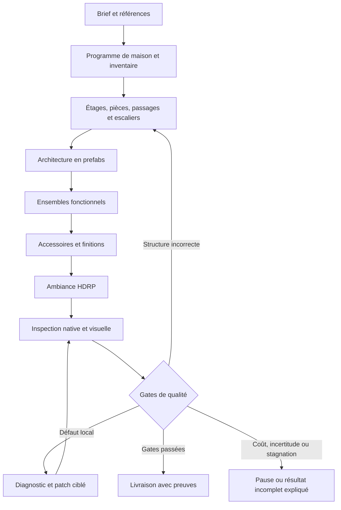

# Plan d’implémentation — agent de maisons et de mapping créatif

Date : 2026-11-01. Branche Git : `main`. Feature Spec Kit : `003-hdrp-scene-agent`.
Statut : implémentation partielle et premiers essais natifs exécutés ; voir `house-implementation-tests.md`. Référence de qualité : [House_worn_night](house-quality-reference.md). Exigences actives : amendement HQ de [spec.md](spec.md).

## Résultat attendu

À partir d’un brief, éventuellement accompagné d’images ou d’un plan, créer une maison Unity explorable, cohérente et aménagée : pièces à échelle plausible, portes et escaliers utilisables, équipements complets, accessoires contextuels, matériaux compatibles et ambiance HDRP. Un lancement utilisateur déclenche toutes les étapes et corrections. La fidélité à une image guide la composition ; les zones non visibles peuvent être conçues selon le brief et sont signalées comme inventions.

Le niveau de détail de la référence est une cible artistique, pas une promesse immédiate ni un quota de 1 713 instances. Les détails doivent renforcer la fonction, l’identité et les parcours. Copier House_worn_night ou parsemer aléatoirement mille objets ne valide pas le produit.

## Technical Context et Constitution Check

Conserver Go 1.27.3 / UI HTML-CSS-JS, Python 3.12 / FastAPI / SQLite, Unity 6000.3.23f1 / HDRP 17.3.0 / C#, macOS Metal, adaptateurs Muse Spark et SAM 3.1 et grand livre existants. Versions observées dans le dépôt ; aucune migration technologique requise pour ce plan. Nouveaux solveurs locaux en Python, validations natives C#, aucune infrastructure distribuée ni dépendance à un entraînement de modèle.

La constitution est un gabarit non renseigné : aucun principe ni approbation additionnelle n’en découle. Gates issus des demandes : prefabs complets à taille native, travail utilisateur préservé, provenance explicite, appels API comptabilisés, capture réellement liée à sa version, distinction exécution/qualité, validation artistique réelle. Verdict avant/après conception : conforme au niveau du design, qualification du produit encore à faire.

Les inconnues techniques sont traitées dans [house-research.md](house-research.md). Les dimensions et orientations des assets sont des mesures à acquérir à J0, pas des suppositions validées. Aucun tarif ou nouveau solde n’est supposé : lire le ledger global, ne jamais le réinitialiser à 150 USD.

## Répartition des responsabilités

| Composant | Responsabilité |
|---|---|
| Muse | Comprendre le brief, proposer les pièces et ensembles, sélectionner styles/assets, interpréter les preuves, proposer les corrections |
| SAM | Localiser des éléments visibles, suivre une région et guider les gros plans ; ne déduit pas seul la métrique ni les contacts |
| Planificateur Python | Inventaire persistant, contraintes, alternatives, ordonnancement, compilation en opérations et décisions de progression |
| Unity C# | Instancier les prefabs, mesurer leurs géométries réelles, vérifier supports/volumes/passages, capturer et appliquer/annuler des transactions |
| Go / chat | Montrer l’avancement par étage/pièce, observations, obligations restantes, corrections, coûts et état réel |
| Utilisateur | Donner le brief et apprécier les jalons artistiques ; pas guider chaque placement ou reprise |

## Ce que l’on conserve et ce que l’on remplace

Conserver : authentification locale, admission des actions, budget/réservations, médias adressés par hash, commandes/reçus/versionnement, instanciation native, tests d’échelle et de faces, captures HDRP et inspecteur du chat. Garder l’ancien parcours comme fixture de régression pendant la migration.

Remplacer dans le nouveau mode : inventaire global de 20 objets (`reference_planner.py`), redimensionnement de toute la grille (`native_layout.compile_grid`), orientation déduite du nom/rectangle, correction limitée aux boîtes 2D (`floorplan.correct_native`) et inspection sans fournisseur de la branche composition (`reference_worker.py`). Une façade explicite sélectionne `house_v1` ; pas d’ajout de conditions dispersées au worker historique.

L’IR d’image est une observation, pas le plan constructible. Une traduction produit un plan métrique cohérent avec les modules disponibles, les besoins de chaque pièce et les passages. Un meuble ne doit pas être retourné de 180° au motif que sa boîte reste identique.

## J0 — Mesurer la référence et qualifier le catalogue

Entrée : House_worn_night, GP et prefabs autorisés. Examiner la référence dans une preview isolée après libération de l’éditeur ; exporter étages, groupes, géométries résolues, matériaux, éclairage et vues intérieures. Hash avant/après identique ; ne pas utiliser ses poses comme vérité terrain pour une nouvelle maison.

Construire `AssetSemantics` : GUID et hash de dépendances, dimensions, pivot, face avant/haut qualifiés, surfaces d’appui, surfaces de dépôt, dégagements d’usage, ouvertures et sockets de raccord, famille de style. Distinguer mesure mécanique et hypothèse sémantique. Pour les assets ambigus : rendu de plusieurs côtés, hypothèse Muse et preuve multivue ou annotation qualifiée, puis test natif des contraintes. La géométrie seule ne prouve pas le sens fonctionnel d’un objet symétrique ; exclure les ambiguïtés non résolues des rôles critiques.

Sortie : catalogue mesuré et atlas des pièces, plus recettes abstraites cuisine, repas, bureau, chambre, sanitaires, salon et stockage. Les recettes expriment des relations et alternatives, pas des coordonnées copiées.

Gate : chaque asset utilisé dans le premier jalon a sa provenance, son orientation et ses supports qualifiés ; un contre-exemple tourné ou posé sur un faux support est détecté.

## J1 — Programme hiérarchique et mémoire de complétude

Créer `HouseProgram`, `Requirement`, `RoomProgram`, `FunctionalGroup` et registre persistant des choix. Une cuisine demandée implique des rôles explicites et traçables ; la présence d’un comptoir ne coche pas « cuisine complète ». Séparer besoins imposés, observés, inférés et décoration libre. Un asset indisponible reste un besoin non satisfait, avec alternative explicite.

Découper les requêtes par étage/pièce/ensemble ; utiliser aperçu global et contexte local ciblé. Les limites d’images, de schéma et de sortie s’appliquent à chaque appel, jamais au total de la maison. Réconcilier les doublons grâce à des identités stables. Une requête tronquée ne valide pas son lot.

Gate : un brief de plusieurs pièces et plus de 20 rôles traverse l’analyse sans perte, chaque besoin ayant un état et une provenance ; reprise après interruption sans doublons ni appels inconnus rejoués.

## J2 — Volumes, architecture et parcours

Introduire `BuildingIR` métrique par étage : élévation, polygones de pièces orthogonaux, dalles, plafonds, limites partagées, portails et connexions verticales. Résoudre les dimensions par besoins locaux et modules, sans agrandir toutes les pièces à chaque cloison. Une croissance doit être justifiée et comparée à une réorganisation ou un autre prefab.

Créer les ouvertures comme entités uniques référencées par les deux faces du mur. Réserver passage, cadre, débattement et seuil. Pour un escalier : module compatible, départ/arrivée, paliers, trémie, garde-corps requis et hauteur libre ; planifier ce volume avant les meubles. Réserver les sorties vers l’extérieur.

Valider sur la géométrie résolue, avec volumes de passage et balayages/casts, pas seulement les colliders parfois absents des packs. Graphe de parcours inter-pièces/inter-étages, plus accès aux zones d’usage. Paramètres initiaux de recette : largeur libre 0,80 m et hauteur libre 2 m, configurables et sans valeur de conformité réglementaire. Le profil fixe aussi capsule, marche maximale (valeur initiale de recette 0,25 m), pente maximale (45° initialement) et continuité d’appui au sol : un parcours ne peut franchir un vide par un saut implicite. Calibrer ces paramètres avec le contrôleur et les modules qualifiés avant campagne.

Gate : toutes les pièces requises sont accessibles depuis l’entrée ; portes et escaliers franchissables dans les deux sens ; pas de dalle traversant une trémie ni de mur bouchant un portail ; proportions de pièces compatibles avec leur programme et leurs modules.

## J3 — Aménagement par ensembles fonctionnels

Placer d’abord les équipements structurants : cuisine, sanitaires, lit, coin salon, bureau, stockage. Choisir leur orientation par faces avant qualifiées et relations : siège vers bureau, TV vers assises, tête de lit contre paroi compatible, mobilier mural adossé et utilisable. Conserver l’échelle native.

Résoudre un ensemble, puis ses relations avec les autres et le parcours. Évaluer des alternatives : rotation, changement de mur, déplacement local, variante compatible ; agrandissement en dernier recours avec pénalité de vide. La complétude, les supports et l’accessibilité priment sur le score pixel.

Gate : tous les équipements obligatoires sont présents ou la création reste incomplète ; aucun meuble flottant/encastré, face avant pertinente, supports réels, portes et espaces d’usage préservés. Les meubles reconnus comme ensemble restent cohérents lors d’une correction.

## J4 — Détails, identité et finitions

Décorer par surfaces et activités : plan de travail avec ustensiles, bureau avec documents, rangement avec livres/boîtes, sanitaires avec serviettes/produits. Surfaces murales : cadres, interrupteurs, prises, éclairages. Sol : tapis et objets appropriés, pas de remplissage aléatoire des passages.

Budgets de densité et diversité par zone, zones volontairement calmes, points d’intérêt et histoire d’usage. Densité mesurée par surface/ensemble et revue visuellement, jamais un simple total d’objets. Contraintes de support, marges, stabilité, intersections et répétitions. Grouper les détails pour les déplacer avec leur support.

Palette par pièce et transitions ; compatibilité des styles, usure et decals adaptés aux matériaux et à l’usage. Modifier uniquement les overrides/matériaux appartenant au run ; ne pas altérer les assets partagés.

Gate : ensembles enrichis avec détails pertinents, aucune surface obligatoire oubliée silencieusement, pas de répétition uniforme ni de désordre involontaire. Validation artistique sur vues de travail et vues de contrôle ; un vote du modèle seul ne certifie pas la qualité.

## J5 — Direction artistique et ambiance HDRP

Séparer rendu technique neutre et rendu livré. Partir des fenêtres/luminaires/écrans réellement présents ; compléter par remplissage justifié, indirect, reflets et volumes. Préserver une exposition lisible et une hiérarchie des points d’intérêt. Conserver les réglages artistiques dans un profil versionné.

D’abord qualifier une petite pièce nocturne. Mesurer l’éclairage avant de lancer un bake coûteux ; attendre la fin réelle du bake et associer ses dépendances au reçu. La preview isolée doit être testée sur Metal ; si les lightmaps/probes ne peuvent pas y être qualifiées, utiliser une copie dédiée dans une instance Unity de validation, avec propriété d’exécution explicite. Ne jamais basculer silencieusement la scène de travail utilisateur.

Gate : vues comparables, absence de fuites/ombres parasites bloquantes, objets et passages lisibles, atmosphère conforme au brief, budget GPU/performance mesuré sur le matériel de recette. Une nuit sombre intentionnelle n’est pas automatiquement une image défectueuse.

## J6 — Observation active et corrections autonomes

Chaque défaut possède une région, des objets, une cause hypothétique, une sévérité et une preuve. Choisir l’action suivante selon le défaut le plus bloquant : mesurer, déplacer la caméra, corriger ou proposer une autre solution. Pas une boucle fixe « six rendus puis terminé ».

Prévoir vues à hauteur d’œil, panoramas, gros plans et traversées de portes/escaliers. Détecter camera dans un mur, sujet hors champ, occlusion massive ou image inutilisable ; repositionner avant de demander un jugement. SAM/Muse accèdent réellement à ces observations dans le nouveau parcours.

Corriger une sous-partie avec transaction et rollback ; invalider les preuves de la zone modifiée et de ses dépendances. Un changement structurel modifie d’abord le BuildingIR versionné, puis recompile les modules affectés ; graphe et scène sont validés ensemble au checkpoint, sinon rollback. Déplacer un mur seul ne peut laisser un portail fictif dans le graphe. Un changement de support invalide ses détails ; un changement de mur invalide ouvertures, parcours et éclairage affectés. Refaire les contrôles globaux susceptibles de régresser.

Arrêts : demande utilisateur, coût non admissible, conflit de version, besoin d’asset non résoluble ou stagnation démontrée après alternatives documentées. Les quotas techniques découpent le travail ; ils ne doivent pas limiter silencieusement le contenu ou faire passer un résultat incomplet pour une réussite. Aucune relance automatique d’appel fournisseur au résultat inconnu.

Gate : défauts injectés (porte bouchée, siège retourné, meuble flottant, caméra occultée, cuisine incomplète) détectés puis réparés ou livrés comme non résolus ; un patch ne détériore pas une pièce précédemment validée.

## J7 — Produit, reprise et campagne de qualité

Chat : vue bâtiment/étages/pièces, ensemble en cours, besoins satisfaits/restants, preuves et corrections avant/après, coût engagé et solde. États d’exécution et de qualité séparés ; « tâche terminée » n’est jamais « maison validée ». Captures horodatées et visualisation des passages/objets inspectés.

Checkpoint à chaque lot validé ; reprendre après redémarrage à partir des reçus, hash de catalogue et versions, sans redoubler les prefabs. Suspendre les mutations si l’utilisateur modifie le même périmètre ; ne pas effacer son travail.

Campagne progressive : A) une pièce riche ; B) deux pièces reliées ; C) rez-de-chaussée et étage ; D) maison avec sous-sol et ambiance nocturne. Pour chaque palier, exécuter au moins trois briefs/variantes, dont un cas sans référence et un plan inédit. Une copie de la maison exemple ne compte pas comme réussite.

Gate de livraison : zéro défaut bloquant de structure/parcours/support ; besoins obligatoires satisfaits ; orientations qualifiées ; inspection exploitable de toutes les pièces/transitions ; qualité artistique acceptée sur le palier. Les seuils de densité et performance sont calibrés sur l’atlas puis figés avant la campagne, jamais choisis après pour faire passer un résultat.

## Ordre de réalisation et tâches

1. J0 + socle données de J1.
2. J2 et J3 sur **une pièce**, avec observation/correction J6 minimale, ordonnanceur durable/budget et états de qualité distincts dès cette étape.
3. J4 + J5 : premier résultat réellement riche, avant d’étendre le bâtiment.
4. J2/J3 étendus à deux pièces puis plusieurs niveaux ; contrôles J6 complets.
5. J7 : campagne et reprise complète ; extension sous-sol/maison entière après les paliers précédents.

Dépendances détaillées : T216–T223 restent les épiques ; T224–T253 de [tasks.md](tasks.md) sont les tâches exécutables. Pas de déclaration de réussite globale fondée uniquement sur les tests unitaires. Les jalons sont des gates qualité, pas une estimation ferme de délai.

## Risques et décisions de repli

- Catalogue mal orienté : qualifier les assets critiques, mettre les autres en attente ; ne pas improviser un yaw depuis leur nom.
- Explosion du nombre d’objets/appels : hiérarchie, recettes locales, cache de catalogue, mutations ciblées, segmentation par besoin ; ne pas supprimer les détails pour rentrer dans un prompt.
- Recherche spatiale coûteuse : géométrie simplifiée conservatrice pour proposer, géométrie native pour accepter ; réduire la zone réoptimisée.
- Ambition maison entière trop élevée pour la campagne : livrer le dernier palier qualifié comme tel, jamais appeler une pièce vide « maison finie ».
- Reprise incompatible avec un ancien run : mode legacy explicitement consultable ; nouveau run/version pour `house_v1`, sans conversion silencieuse de plans historiques.

## Artefacts de conception

[Recherche](house-research.md) · [Modèle de données](house-data-model.md) · [Contrats](contracts/house-generation.md) · [Guide de validation](house-quickstart.md) · [Tâches](tasks.md).

## Pièces habitées — complément demandé le 1 novembre 2026

Une fonction de pièce déclenche un programme d'usages, sans exiger que l'utilisateur énumère chaque objet. Un bureau meublé peut proposer travail, bibliothèque/livres, plantes et coin lecture ou accueil ; un lit répond à un usage mixte explicite ou suggéré par le brief. Les exclusions et demandes minimalistes priment. Muse choisit un sous-ensemble adapté à la surface ; le solveur place les groupes obligatoires avant les compléments, conserve les dimensions natives et signale les extras qui ne tiennent pas.

Recettes ajoutées : `library`, `reading`, `lounge`, `plant`. Les livres privilégient les supports de bibliothèque qualifiés ; contrôle de hauteur entre tablettes et séparation des objets. Le catalogue distingue assets qualifiés et non qualifiés dans le contexte modèle. Cette extension ne qualifie pas encore les cadres muraux, tapis ou luminaires.

## Boucle de correction et de complétude — 1 novembre 2026

Après la première inspection, sélectionner une correction d'exposition mesurée, une transformation de groupe proposée par Muse, ou un complément d'aménagement motivé par un défaut d'inventaire/composition. Conserver le manifeste retenu, les obligations et les essais rejetés. Construire chaque candidat dans une scène propre au run ; cette première version reconstruit une copie isolée, sans modifier la scène source ni écraser le candidat retenu. Les captures sont versionnées par hash de manifeste.

Réinspecter le candidat avec SAM/Muse après contrôle natif. Refuser les nouveaux défauts géométriques, la disparition d'équipements et les régressions visuelles ; accepter une réduction de défaut, une correction de luminosité mesurée ou un ajout supporté sans nouveau défaut observé. Les déplacements réévaluent les accès fonctionnels, les compléments respectent les instances existantes. Pas de quota d'itérations : arrêt sur absence de nouvelle proposition admissible, état déjà essayé, budget, commande incertaine ou arrêt utilisateur. Les contrôles encore non qualifiés ne deviennent pas positifs par simple fin de boucle.

Afficher les passes proposées/conservées/rejetées et le motif d'arrêt dans le chat. Une fin sans convergence conserve `quality_state=incomplete` et indique `execution_state=stalled`. Le candidat retenu reste celui affiché à la fin, même si le dernier essai a été rejeté. L'édition native strictement locale et la reprise après redémarrage restent des travaux distincts.

### Mémoire compacte et éclairage fonctionnel (2 novembre)

Chaque run conserve `memory/STATE.md`, une synthèse par pièce `room-<hash>.md`, les sorties structurées du modèle dans `analysis-<hash>.md` et les contextes intégraux dans des archives JSON adressées par hash. Les appels d’inspection et d’enrichissement relisent la synthèse de leur pièce : tous les besoins non satisfaits restent présents, les doublons de défauts et métadonnées de reçus sont retirés du contexte courant. Les preuves complètes restent dans les archives ; ces documents ne constituent pas une qualification ni une reprise automatique d’appels inconnus.

Les images d’inspection sont transportées en JPEG à résolution conservée, par lots limités en octets et en nombre, sans supprimer de vues. Les plafonniers sont des instances complètes du prefab du projet, montées selon leurs bounds et réparties selon la surface. Sources HDRP en temps réel et reçus natifs ; bake indirect et lumière artistique restent ouverts.

### Flux caméra d’inspection

Unity publie au plus cinq images JPEG par seconde pendant ses rendus d’inspection. Go les diffuse sur une connexion MJPEG authentifiée, limitée au run de l’action. Les images périmées cessent d’être présentées comme direct. Le panneau conserve les preuves fixes et les cadres SAM, sans plaquer une ancienne segmentation sur une nouvelle image vidéo. Ce flux d’affichage ne remplace pas les images probantes envoyées à Muse/SAM ; la caméra cesse d’émettre quand le job natif ferme sa scène isolée.

### Priorité décoration au sol et inspection vidéo

Les `detail_assets` peuvent inclure les tapis et les groupes de feuilles/decal-papers du pack. Le solveur utilise une recette de surface plane (bounds mesurés, épaisseur ≤ 5 cm, racines de prefab autorisées), sans leur inventer une face fonctionnelle. Placement natif près des usages, hors portes, mobilier et autres décors. Chaque besoin reste enregistré même sans place disponible. Unity vérifie appui et parcours réel sur ces surfaces ; aucune suppression de collision globale. Le programme de pièce expose explicitement les variantes disponibles et leurs dimensions. Les lampes plafond utilisent désormais Lamp_ceiling_round et les observations comprennent une vue au sol et une vue au plafond.

### Disposition explicite par le modèle

Le contrat ModelHouseRoomV2 exige les slots de prefab, offsets, relations de support, ancre et rotation de chaque groupe. La recette devient une étiquette d’usage, sans injection automatique de Workdesk/Chair_kitchen. Le chemin historique reste compatible avec les anciennes données, mais les nouveaux appels utilisent V2. Le solveur contrôle le placement proposé sans le rabattre sur un modèle mural fixe. Les assets HouseProps disposent d’identifiants préfixés pour éviter les collisions de noms. Une orientation inconnue peut être proposée explicitement, sans qualification implicite ; les surfaces porteuses restent contrôlées et les défauts de pose sont soumis à la revue visuelle.

### Correction des intersections et des observations contaminées (2026-11-02)

Les slots explicites vérifient désormais les intersections volumétriques entre objets et le dégagement au-dessus de la surface porteuse, avec coordonnées relatives au pivot du support. Les besoins refusés restent manquants, sans substitution. Ces tests conservateurs ne constituent pas encore une certification des collisions par maillage natif.

Les scènes additives partageaient le masque de visibilité du main stage : l’inspection pouvait inclure les objets d’un ancien candidat ouvert par l’utilisateur. Après sauvegarde, le job attribue un bit de visibilité exclusif et un layer temporaire inutilisé (volumes/exposition), sans modifier la scène utilisateur ni enregistrer ces changements d’inspection. Échec explicite si l’isolation est impossible. Le reçu de construction indique un bake en attente, jamais « non requis » ; cette correction ne réalise pas le bake.

Validation : 355 tests Python réussis, compilation Unity réussie. Essai isolé `35a4c58368794eaa85fb3d33375e5d2f`, 9 instances natives, 17 vues, appuis/parcours réussis et scène source inchangée. Les plantes étrangères observées avant isolation ont disparu. Revue visuelle non validée : matériau HouseProps rose, cônes lumineux marqués, bibliothèque vide et bake absent. L’assemblage reste un candidat technique, pas une pièce livrable. Les tests de collision sont conservateurs ; une campagne de défauts injectés natifs reste nécessaire.

### Cible artistique utilisateur : House_clean_day (2026-11-02)

Référence principale : `Assets/AtmosphericHouse/Scenes/House_clean_day.unity`. Capture de recette fournie : `/Users/romain/Desktop/Capture d’écran 2026-11-02 à 13.53.27.png`. La chambre montre une lumière latérale filtrée par les rideaux, un contraste intérieur/extérieur, des ombres de contact douces, des surfaces textiles et murales cohérentes, des rangements garnis, des affiches, des boîtes, un panier, du linge et quelques objets au sol. Densité organisée et passage libre ; ni pièce vide ni accumulation aléatoire. Cette cible remplace l’acceptation d’un simple bureau équipé sous des spots plafond. Les usages et poses restent propres à chaque demande.

Audit des assets sérialisés (sans ouvrir/modifier la référence) : scène liée à un LightingDataAsset et à `House_clean_daySettings.lighting` ; lightmaps baked activées, realtime lightmaps désactivées, résolution 45 texels/m, atlas 2048, 3 rebonds, échantillons direct/indirect/environnement 64/512/256. La scène comporte des fills baked et des sources temps réel SpecOnly, ainsi qu’un soleil directionnel (intensité sérialisée 250). Elle référence le profil HDRP `House_clean_day_SceneSettings` (ciel physique, brouillard, ombres, diffusion). Attention : le profil PostProcessing référencé réside dans le dossier URP ; son équivalence HDRP doit être vérifiée composant par composant. Les valeurs d’un asset sérialisé ne constituent pas une mesure du rendu ni un preset transposable sans vérifier unités, géométrie et version Unity.

Exécution : la cible est injectée dans la programmation ET la revue visuelle. Cela ne suffit pas à réaliser l’éclairage. Il reste à adapter les ouvertures et le soleil, produire des réglages HDRP propres au candidat, calculer sa propre lumière indirecte et ses probes en isolation, puis comparer des vues à hauteur humaine avec la référence. Ne jamais réutiliser les lightmaps de la maison source pour une géométrie différente. Une recette native sans défaut structurel ne vaut pas validation artistique.

### Vision, ressources et construction progressive — correction du 2026-11-02

Constats vérifiés : SAM était appelé avec le seul concept `furniture`; ses rasters étaient archivés mais le front ne traçait que les bounding boxes, et Muse ne recevait pas les masques en pixels. Le catalogue exposait surtout identifiants/dimensions et l'assemblage initial appliquait la pièce entière. Enfin, une observation non exécutable ne déclenchait pas nécessairement de replanification avant NO_SAFE_PROGRESS.

Implémentation : concepts SAM déduits des familles de prefabs réellement planifiées, avec rasters superposés aux captures, affichage authentifié dans « Masques SAM » et mêmes images annotées pour Muse. Les pixels non segmentés ne prouvent jamais une absence. Le catalogue expose toutes ses familles, chemins, styles et régions de support qualifiées ; la sélection visuelle par vignettes reste à ajouter. Le plan global conserve les intentions, puis chaque groupe fonctionnel et ses enfants portés sont construits/inspectés avant le suivant. Défauts natifs : rejet du candidat ; défauts visuels de pose : correction et nouvelle inspection, sinon zone conservée comme besoin non satisfait. Le moteur Unity produit encore des snapshots cumulatifs, pas des mutations locales in-place. La revue globale finale et la non-régression restent nécessaires.

Quand aucune action n'est exécutable, nouvelle demande de corrections concrètes avec inventaire, géométrie, preuves et mémoire des rejets. Éviter de répéter un état/raisonnement identique ; aucun plafond fixe de passes. Les corrections disponibles restent déplacements/rotations de groupes, enrichissement et exposition : une fonctionnalité absente (bake, modification de matériaux, pose murale non qualifiée) doit rester un blocage explicite, jamais un faux succès.

### Référence lumineuse native exploitable

Menu Unity : `Tools > HDRP Agent > House > Export clean day lighting data`. Chargement dans une preview, sans changer la scène utilisateur ; export `.hdrp-agent/references/clean-day/lighting.json` et contexte `lighting-context.json`. Export effectué : 141 sources (y compris celles des prefabs), 2 volumes, 88 matériaux, 4 reflection probes, 1 groupe de light probes, 1 volume APV ; source et scène utilisateur inchangées. Les sources des modules de fenêtre comptent dans l'éclairage, contrairement à une description réduite à un soleil et des plafonniers.

Données : intensités ET unités natives, transforms, activation, couleurs/températures, modes baked/temps réel, cônes, réglages HDRP sérialisés, paramètres de volumes, shaders/matériaux, probes et LightingSettings. Conservation intégrale ; regroupement uniquement des réglages identiques dans le contexte modèle, avec toutes les instances. Hash de la scène source vérifié à la lecture ; snapshot des dépendances daté par l'export Unity, sans prétendre revalider les dépendances modifiées hors export. Cette connaissance est injectée dans programmation, inspection, corrections et enrichissement. Elle ne transpose ni les lightmaps ni les poses à une nouvelle géométrie. Le profil postprocess référencé par cette scène expose zéro composant lors du chargement HDRP actuel : ne pas inventer une exposition copiée de ce profil.

## Direct visual interaction experiment

Before replacing generation wholesale, qualify a narrow table/seating correction using a persistent isolated copy of the latest generated scene. The agent receives native object transforms, actual multi-angle prefab previews and a source-scene reference. It may request camera positions, apply exact object poses and undo its own changes. Geometry checks reject invalid operations without silently repositioning objects. Original and unrelated scenes remain unchanged. Each operation has an immutable request/result, an expected scene-state hash and explicit observations. Provider proposals are not evidence of improvement.

The first delivery is a repeatable local experiment with a visual before/after report, not a claim that the full chat generation pipeline has been replaced. Promotion to the chat requires successful native and model validation of this interaction path.

## Autonomous bedroom quality campaign (2026-11-02)

The goal is a furnished bedroom comparable to House_clean_day, produced autonomously and repeatably. A passing transport test or a small successful furniture move is not acceptance. Preserve source scenes and use the shared API ledger for every paid call.

1. Repair saved HDRP volume components and verify serialized exposure/tonemapping after reimport. Existing generated Lighting assets contain null component references; do not silently repair historical evidence.
2. Establish candidate-owned daylight, indirect lighting and bake evidence, using the measured reference settings rather than copying lightmaps from different geometry. Qualify captures after reopening the scene.
3. Expose actual multi-angle asset previews and bedroom reference details to selection. Require functional anchors, furnished storage, textiles, wall decoration and plausible everyday objects, with explicit unavailable-resource reporting.
4. Extend persistent visual interaction beyond the pair experiment, retaining exact moves, reversible edits, close inspection, support and traversal checks. Corrections must change the observed scene and be re-evaluated.
5. Run three independent bedroom generations with different requested arrangements. Keep complete manifests, budget receipts, before/after observations and defect history. All must preserve passages, contacts, prefab scale and architecture and meet the visual reference standard. Repetition means reliable quality, not an identical hardcoded arrangement.

Do not declare the goal complete while lighting is unqualified, essential furnishings are absent, visible defects remain, or only one run has been evaluated.

T281 evidence: native `Test volume profile persistence` passed after unloading components/profile and forcing reimport; the file contains both component records, exposure 6.25 and ACES, and both loaded components resolve to the owned asset path. Report: `.hdrp-agent/reports/profile-persistence.json`. Existing historical `Lighting 5.asset` in run e523a50d4782482cb5c7cd6bac4c58c5 contains two null component references and was left unchanged. Unity compilation and 381 Python tests passed. This establishes persistence, not visual equivalence or bake quality.

### Visual resource discovery evidence

The native incremental exporter now renders both project prefab roots into `.hdrp-agent/house/visual-catalogue`, preserving GUID, dependency hash and image hash. It completed 1,029 two-angle previews; six non-renderable light/controller prefabs have explicit failures. Active scene path and dirty state remained unchanged. Reload interruption is resumable by starting the exporter again; ready matching files are reused.

Room planning now chooses relevant resource families, reviews every page of their actual images with Muse, validates that selections belong to the observed page, and carries the selected IDs, visual notes and provenance into composition and Markdown memory. Pages contain four prefabs each at 1280×720 to meet the existing image transport contract; pagination does not truncate the selected families. Preview appearance never upgrades front/support qualification. The catalogue remains available beyond the selected shortlist.

A budget-accounted live test selected Bed_twin for a child bedroom and rejected Sofa_3seat and the oversized Bed_king, describing their visible materials and measured dimensions. Evidence: `.hdrp-agent/reports/catalogue-live/result.json` and `page.png`; cost USD 0.0003649. This validates image delivery and one grounded selection, not whole-room composition. The running backend still needs the new code loaded before the next end-to-end campaign. Full suite: 385 passed before two additional browsing tests; final targeted catalogue suite: 6 passed.

### Support discovery and campaign restart

Attempt 1 (`073ca8526fcb4a2abfb9a852ba7f1621`) selected 392 candidates over 98 pages. It was explicitly stopped before native construction because one call per page delayed useful scene feedback. Completed observations remain archived; terminal STOP_REQUESTED and zero active native commands were verified before service restart.

Visual review now sends up to twelve pages per transport batch, covering every selected page. It does not discard candidates or impose an analysis-round quota. Selected room assets are then reviewed individually for functional front and accessible rigid supports. Support proposals are inset rectangles fully covered by actual measured triangles; holes and duplicate triangles are rejected and overhead clearance is reported. The model may select only supplied patch IDs, may leave front unknown, and cannot invent geometry or overwrite already reviewed fronts. Qualification records retain the exact preview hash, dependency hash and structured decision. Runtime contact/collision checks remain necessary.

Live support review of Side_table_E selected the visible top and two shelves and left the front unknown; cost USD 0.0004515, evidence `.hdrp-agent/reports/support-review-live.json`. This is one reviewed prefab, not whole-catalogue qualification. Full Python suite: 392 passed.

Attempt 2 (`39272a15ca2c469681b5018825432047`, action `campaign-f56c7ffc2d164fbd8d59509b411a11d2`) was admitted after deploying these changes. Track the existing action and process; do not relaunch on a polling timeout. Requests and admissions are archived in `.hdrp-agent/reports/bedroom-quality-campaign/attempt-2.json`. Bedroom composition, lighting and repeatability remain unproven.

Attempt 2 ended before native construction with VERTICAL_ACCESS_UNQUALIFIED: the model assigned floor_index=1 to the sole room. The outline prompt now explicitly defines zero-based floors and the service sends validator feedback back to the model before furnishing. Repeated identical invalid outlines terminate without replaying forever; user-requested floors must not be silently removed. Both behaviors have integration tests (19 house-action tests passed). Attempt 3 (`4b2f10b9604a44e086b0bc4dfae0f9fc`, action `campaign-50407e66068043089eb762c1fcd2fec5`) was admitted after verifying zero active sessions/commands and deploying the fix; admission is in `attempt-3.json`. Track this existing run next.

### Typed visual choices and inspection throughput

Attempt 3 failed before construction because family discovery returned individual prefab IDs. `ModelHouseCatalogueChoice` now binds its `selected` enum to the exact family IDs or page asset IDs supplied for that call; the provider request verifier reconstructs the same binding. Contract tests reject wrong-level identifiers. Attempt 4 (`82ecb95b1cf4441eb3fb85ffc34fd90f`, action `campaign-6a7784ef65d24e3cb970b927bf4e8e61`) is running with this fix, archived in `attempt-4.json`. Its first batch selected Bed_twin and child-reachable storage, rejecting the adult bed and oversized shelving. This remains selection evidence only; follow the existing run through assembly.

SAM concept queries for each image now use four independent provider clients/reservations concurrently, preserving deterministic evidence order. Executor shutdown joins in-flight calls on error or stop so paid responses are not abandoned. A barrier-based integration test verifies actual concurrency and stable result association. This throughput change is tested but not loaded in the ongoing attempt 4 backend; deploy only after that run reaches a terminal state. Full suite: 396 passed.

### Attempt 4: first native evidence and photometric defect

Attempt 4 reached an actual sleeping-zone build. Native captures in `.hdrp-agent/house/runs/82ecb95b1cf4441eb3fb85ffc34fd90f/b44e8c1ffc73` show a substantially overexposed white room; artistic acceptance fails. The saved exposure profile is present, so this is distinct from the previously repaired serialization defect. Unity 6000.3 HDRP source confirms that `Light.intensity` uses candelas for punctual lights, lux for directional/box lights and nits for area lights; `lightUnit` controls the selected display unit. The builders had assigned lumen values directly as native intensity. `PhotometricIntensity.Set` now converts using the actual light shape/reflector/angle after configuring the light. The native test passed (810 lm point and non-reflector spot = 64.45775 cd; directional 250 lx remains 250). The exact factor for the ceiling prefab depends on its reflector and angle and must come from the native receipt, not the point-light test.

The model plan also placed Wardrobe and Dresser_C only 1.5m apart along their rotated widths, producing an internal group overlap that no group translation can solve. Offline placement retained 14 instances but omitted both mandatory storage pieces. Preflight now reports these local overlaps to the model and iterates distinct complete plans before construction, retaining the best placement and preventing a lower failure score by removing/demoting mandatory planned asset counts. New support/front qualification triggers design revision before placement, so an earlier bedside-lamp substitution can be reconsidered. Access checks and prompts now use the reviewed native front instead of assuming +Z. These Python changes are not yet loaded in the backend. Full suite before the final cache-key/quantity refinements: 405 passed; targeted house-action tests rerun afterward.

Attempt 4 was explicitly stopped; its terminal STOP_REQUESTED and zero active native commands were verified before native compilation. Photometric comparison is queued under run `c1b216d3ec7441d998a4b9edcfea6e44`, command `lighting-command-c1b216d3ec7441d998a4b9edcfea6e44`, session `lighting-c1b216d3ec7441d998a4b9edcfea6e44`. It reuses the exact first-zone manifest/cameras with a new output run ID and makes no paid model call. Evidence/report: `.hdrp-agent/reports/photometric-comparison.json`. Poll the existing command and process; do not replay. The Mac subsequently became locked (IOConsoleUsers reports CGSSessionScreenIsLocked=true), Unity stopped polling and the comparison remains queued. An asynchronous unlock question is pending. The background qualification script handle is 70149. Do not claim a corrected render until the native comparison completes and is viewed.
