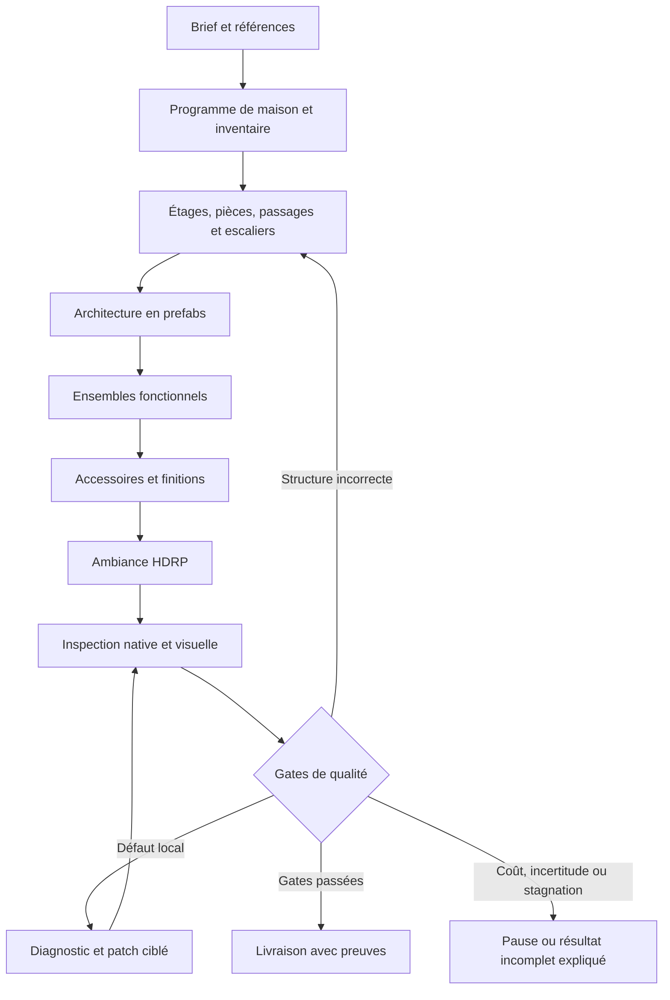

# Plan d’implémentation — agent de maisons et de mapping créatif

Date : 2026-11-01. Branche Git : `main`. Feature Spec Kit : `003-hdrp-scene-agent`.
Statut : implémentation partielle et premiers essais natifs exécutés ; voir `house-implementation-tests.md`. Référence de qualité : [House_worn_night](house-quality-reference.md). Exigences actives : amendement HQ de [spec.md](spec.md).

## Résultat attendu

À partir d’un brief, éventuellement accompagné d’images ou d’un plan, créer une maison Unity explorable, cohérente et aménagée : pièces à échelle plausible, portes et escaliers utilisables, équipements complets, accessoires contextuels, matériaux compatibles et ambiance HDRP. Un lancement utilisateur déclenche toutes les étapes et corrections. La fidélité à une image guide la composition ; les zones non visibles peuvent être conçues selon le brief et sont signalées comme inventions.

Le niveau de détail de la référence est une cible artistique, pas une promesse immédiate ni un quota de 1 713 instances. Les détails doivent renforcer la fonction, l’identité et les parcours. Copier House_worn_night ou parsemer aléatoirement mille objets ne valide pas le produit.

## Technical Context et Constitution Check

Conserver Go 1.27.3 / UI HTML-CSS-JS, Python 3.12 / FastAPI / SQLite, Unity 6000.3.23f1 / HDRP 17.3.0 / C#, macOS Metal, adaptateurs Muse Spark et SAM 3.1 et grand livre existants. Versions observées dans le dépôt ; aucune migration technologique requise pour ce plan. Nouveaux solveurs locaux en Python, validations natives C#, aucune infrastructure distribuée ni dépendance à un entraînement de modèle.

La constitution est un gabarit non renseigné : aucun principe ni approbation additionnelle n’en découle. Gates issus des demandes : prefabs complets à taille native, travail utilisateur préservé, provenance explicite, appels API comptabilisés, capture réellement liée à sa version, distinction exécution/qualité, validation artistique réelle. Verdict avant/après conception : conforme au niveau du design, qualification du produit encore à faire.

Les inconnues techniques sont traitées dans [house-research.md](house-research.md). Les dimensions et orientations des assets sont des mesures à acquérir à J0, pas des suppositions validées. Aucun tarif ou nouveau solde n’est supposé : lire le ledger global, ne jamais le réinitialiser à 150 USD.

## Répartition des responsabilités

| Composant | Responsabilité |
|---|---|
| Muse | Comprendre le brief, proposer les pièces et ensembles, sélectionner styles/assets, interpréter les preuves, proposer les corrections |
| SAM | Localiser des éléments visibles, suivre une région et guider les gros plans ; ne déduit pas seul la métrique ni les contacts |
| Planificateur Python | Inventaire persistant, contraintes, alternatives, ordonnancement, compilation en opérations et décisions de progression |
| Unity C# | Instancier les prefabs, mesurer leurs géométries réelles, vérifier supports/volumes/passages, capturer et appliquer/annuler des transactions |
| Go / chat | Montrer l’avancement par étage/pièce, observations, obligations restantes, corrections, coûts et état réel |
| Utilisateur | Donner le brief et apprécier les jalons artistiques ; pas guider chaque placement ou reprise |

## Ce que l’on conserve et ce que l’on remplace

Conserver : authentification locale, admission des actions, budget/réservations, médias adressés par hash, commandes/reçus/versionnement, instanciation native, tests d’échelle et de faces, captures HDRP et inspecteur du chat. Garder l’ancien parcours comme fixture de régression pendant la migration.

Remplacer dans le nouveau mode : inventaire global de 20 objets (`reference_planner.py`), redimensionnement de toute la grille (`native_layout.compile_grid`), orientation déduite du nom/rectangle, correction limitée aux boîtes 2D (`floorplan.correct_native`) et inspection sans fournisseur de la branche composition (`reference_worker.py`). Une façade explicite sélectionne `house_v1` ; pas d’ajout de conditions dispersées au worker historique.

L’IR d’image est une observation, pas le plan constructible. Une traduction produit un plan métrique cohérent avec les modules disponibles, les besoins de chaque pièce et les passages. Un meuble ne doit pas être retourné de 180° au motif que sa boîte reste identique.

## J0 — Mesurer la référence et qualifier le catalogue

Entrée : House_worn_night, GP et prefabs autorisés. Examiner la référence dans une preview isolée après libération de l’éditeur ; exporter étages, groupes, géométries résolues, matériaux, éclairage et vues intérieures. Hash avant/après identique ; ne pas utiliser ses poses comme vérité terrain pour une nouvelle maison.

Construire `AssetSemantics` : GUID et hash de dépendances, dimensions, pivot, face avant/haut qualifiés, surfaces d’appui, surfaces de dépôt, dégagements d’usage, ouvertures et sockets de raccord, famille de style. Distinguer mesure mécanique et hypothèse sémantique. Pour les assets ambigus : rendu de plusieurs côtés, hypothèse Muse et preuve multivue ou annotation qualifiée, puis test natif des contraintes. La géométrie seule ne prouve pas le sens fonctionnel d’un objet symétrique ; exclure les ambiguïtés non résolues des rôles critiques.

Sortie : catalogue mesuré et atlas des pièces, plus recettes abstraites cuisine, repas, bureau, chambre, sanitaires, salon et stockage. Les recettes expriment des relations et alternatives, pas des coordonnées copiées.

Gate : chaque asset utilisé dans le premier jalon a sa provenance, son orientation et ses supports qualifiés ; un contre-exemple tourné ou posé sur un faux support est détecté.

## J1 — Programme hiérarchique et mémoire de complétude

Créer `HouseProgram`, `Requirement`, `RoomProgram`, `FunctionalGroup` et registre persistant des choix. Une cuisine demandée implique des rôles explicites et traçables ; la présence d’un comptoir ne coche pas « cuisine complète ». Séparer besoins imposés, observés, inférés et décoration libre. Un asset indisponible reste un besoin non satisfait, avec alternative explicite.

Découper les requêtes par étage/pièce/ensemble ; utiliser aperçu global et contexte local ciblé. Les limites d’images, de schéma et de sortie s’appliquent à chaque appel, jamais au total de la maison. Réconcilier les doublons grâce à des identités stables. Une requête tronquée ne valide pas son lot.

Gate : un brief de plusieurs pièces et plus de 20 rôles traverse l’analyse sans perte, chaque besoin ayant un état et une provenance ; reprise après interruption sans doublons ni appels inconnus rejoués.

## J2 — Volumes, architecture et parcours

Introduire `BuildingIR` métrique par étage : élévation, polygones de pièces orthogonaux, dalles, plafonds, limites partagées, portails et connexions verticales. Résoudre les dimensions par besoins locaux et modules, sans agrandir toutes les pièces à chaque cloison. Une croissance doit être justifiée et comparée à une réorganisation ou un autre prefab.

Créer les ouvertures comme entités uniques référencées par les deux faces du mur. Réserver passage, cadre, débattement et seuil. Pour un escalier : module compatible, départ/arrivée, paliers, trémie, garde-corps requis et hauteur libre ; planifier ce volume avant les meubles. Réserver les sorties vers l’extérieur.

Valider sur la géométrie résolue, avec volumes de passage et balayages/casts, pas seulement les colliders parfois absents des packs. Graphe de parcours inter-pièces/inter-étages, plus accès aux zones d’usage. Paramètres initiaux de recette : largeur libre 0,80 m et hauteur libre 2 m, configurables et sans valeur de conformité réglementaire. Le profil fixe aussi capsule, marche maximale (valeur initiale de recette 0,25 m), pente maximale (45° initialement) et continuité d’appui au sol : un parcours ne peut franchir un vide par un saut implicite. Calibrer ces paramètres avec le contrôleur et les modules qualifiés avant campagne.

Gate : toutes les pièces requises sont accessibles depuis l’entrée ; portes et escaliers franchissables dans les deux sens ; pas de dalle traversant une trémie ni de mur bouchant un portail ; proportions de pièces compatibles avec leur programme et leurs modules.

## J3 — Aménagement par ensembles fonctionnels

Placer d’abord les équipements structurants : cuisine, sanitaires, lit, coin salon, bureau, stockage. Choisir leur orientation par faces avant qualifiées et relations : siège vers bureau, TV vers assises, tête de lit contre paroi compatible, mobilier mural adossé et utilisable. Conserver l’échelle native.

Résoudre un ensemble, puis ses relations avec les autres et le parcours. Évaluer des alternatives : rotation, changement de mur, déplacement local, variante compatible ; agrandissement en dernier recours avec pénalité de vide. La complétude, les supports et l’accessibilité priment sur le score pixel.

Gate : tous les équipements obligatoires sont présents ou la création reste incomplète ; aucun meuble flottant/encastré, face avant pertinente, supports réels, portes et espaces d’usage préservés. Les meubles reconnus comme ensemble restent cohérents lors d’une correction.

## J4 — Détails, identité et finitions

Décorer par surfaces et activités : plan de travail avec ustensiles, bureau avec documents, rangement avec livres/boîtes, sanitaires avec serviettes/produits. Surfaces murales : cadres, interrupteurs, prises, éclairages. Sol : tapis et objets appropriés, pas de remplissage aléatoire des passages.

Budgets de densité et diversité par zone, zones volontairement calmes, points d’intérêt et histoire d’usage. Densité mesurée par surface/ensemble et revue visuellement, jamais un simple total d’objets. Contraintes de support, marges, stabilité, intersections et répétitions. Grouper les détails pour les déplacer avec leur support.

Palette par pièce et transitions ; compatibilité des styles, usure et decals adaptés aux matériaux et à l’usage. Modifier uniquement les overrides/matériaux appartenant au run ; ne pas altérer les assets partagés.

Gate : ensembles enrichis avec détails pertinents, aucune surface obligatoire oubliée silencieusement, pas de répétition uniforme ni de désordre involontaire. Validation artistique sur vues de travail et vues de contrôle ; un vote du modèle seul ne certifie pas la qualité.

## J5 — Direction artistique et ambiance HDRP

Séparer rendu technique neutre et rendu livré. Partir des fenêtres/luminaires/écrans réellement présents ; compléter par remplissage justifié, indirect, reflets et volumes. Préserver une exposition lisible et une hiérarchie des points d’intérêt. Conserver les réglages artistiques dans un profil versionné.

D’abord qualifier une petite pièce nocturne. Mesurer l’éclairage avant de lancer un bake coûteux ; attendre la fin réelle du bake et associer ses dépendances au reçu. La preview isolée doit être testée sur Metal ; si les lightmaps/probes ne peuvent pas y être qualifiées, utiliser une copie dédiée dans une instance Unity de validation, avec propriété d’exécution explicite. Ne jamais basculer silencieusement la scène de travail utilisateur.

Gate : vues comparables, absence de fuites/ombres parasites bloquantes, objets et passages lisibles, atmosphère conforme au brief, budget GPU/performance mesuré sur le matériel de recette. Une nuit sombre intentionnelle n’est pas automatiquement une image défectueuse.

## J6 — Observation active et corrections autonomes

Chaque défaut possède une région, des objets, une cause hypothétique, une sévérité et une preuve. Choisir l’action suivante selon le défaut le plus bloquant : mesurer, déplacer la caméra, corriger ou proposer une autre solution. Pas une boucle fixe « six rendus puis terminé ».

Prévoir vues à hauteur d’œil, panoramas, gros plans et traversées de portes/escaliers. Détecter camera dans un mur, sujet hors champ, occlusion massive ou image inutilisable ; repositionner avant de demander un jugement. SAM/Muse accèdent réellement à ces observations dans le nouveau parcours.

Corriger une sous-partie avec transaction et rollback ; invalider les preuves de la zone modifiée et de ses dépendances. Un changement structurel modifie d’abord le BuildingIR versionné, puis recompile les modules affectés ; graphe et scène sont validés ensemble au checkpoint, sinon rollback. Déplacer un mur seul ne peut laisser un portail fictif dans le graphe. Un changement de support invalide ses détails ; un changement de mur invalide ouvertures, parcours et éclairage affectés. Refaire les contrôles globaux susceptibles de régresser.

Arrêts : demande utilisateur, coût non admissible, conflit de version, besoin d’asset non résoluble ou stagnation démontrée après alternatives documentées. Les quotas techniques découpent le travail ; ils ne doivent pas limiter silencieusement le contenu ou faire passer un résultat incomplet pour une réussite. Aucune relance automatique d’appel fournisseur au résultat inconnu.

Gate : défauts injectés (porte bouchée, siège retourné, meuble flottant, caméra occultée, cuisine incomplète) détectés puis réparés ou livrés comme non résolus ; un patch ne détériore pas une pièce précédemment validée.

## J7 — Produit, reprise et campagne de qualité

Chat : vue bâtiment/étages/pièces, ensemble en cours, besoins satisfaits/restants, preuves et corrections avant/après, coût engagé et solde. États d’exécution et de qualité séparés ; « tâche terminée » n’est jamais « maison validée ». Captures horodatées et visualisation des passages/objets inspectés.

Checkpoint à chaque lot validé ; reprendre après redémarrage à partir des reçus, hash de catalogue et versions, sans redoubler les prefabs. Suspendre les mutations si l’utilisateur modifie le même périmètre ; ne pas effacer son travail.

Campagne progressive : A) une pièce riche ; B) deux pièces reliées ; C) rez-de-chaussée et étage ; D) maison avec sous-sol et ambiance nocturne. Pour chaque palier, exécuter au moins trois briefs/variantes, dont un cas sans référence et un plan inédit. Une copie de la maison exemple ne compte pas comme réussite.

Gate de livraison : zéro défaut bloquant de structure/parcours/support ; besoins obligatoires satisfaits ; orientations qualifiées ; inspection exploitable de toutes les pièces/transitions ; qualité artistique acceptée sur le palier. Les seuils de densité et performance sont calibrés sur l’atlas puis figés avant la campagne, jamais choisis après pour faire passer un résultat.

## Ordre de réalisation et tâches

1. J0 + socle données de J1.
2. J2 et J3 sur **une pièce**, avec observation/correction J6 minimale, ordonnanceur durable/budget et états de qualité distincts dès cette étape.
3. J4 + J5 : premier résultat réellement riche, avant d’étendre le bâtiment.
4. J2/J3 étendus à deux pièces puis plusieurs niveaux ; contrôles J6 complets.
5. J7 : campagne et reprise complète ; extension sous-sol/maison entière après les paliers précédents.

Dépendances détaillées : T216–T223 restent les épiques ; T224–T253 de [tasks.md](tasks.md) sont les tâches exécutables. Pas de déclaration de réussite globale fondée uniquement sur les tests unitaires. Les jalons sont des gates qualité, pas une estimation ferme de délai.

## Risques et décisions de repli

- Catalogue mal orienté : qualifier les assets critiques, mettre les autres en attente ; ne pas improviser un yaw depuis leur nom.
- Explosion du nombre d’objets/appels : hiérarchie, recettes locales, cache de catalogue, mutations ciblées, segmentation par besoin ; ne pas supprimer les détails pour rentrer dans un prompt.
- Recherche spatiale coûteuse : géométrie simplifiée conservatrice pour proposer, géométrie native pour accepter ; réduire la zone réoptimisée.
- Ambition maison entière trop élevée pour la campagne : livrer le dernier palier qualifié comme tel, jamais appeler une pièce vide « maison finie ».
- Reprise incompatible avec un ancien run : mode legacy explicitement consultable ; nouveau run/version pour `house_v1`, sans conversion silencieuse de plans historiques.

## Artefacts de conception

[Recherche](house-research.md) · [Modèle de données](house-data-model.md) · [Contrats](contracts/house-generation.md) · [Guide de validation](house-quickstart.md) · [Tâches](tasks.md).

## Pièces habitées — complément demandé le 1 novembre 2026

Une fonction de pièce déclenche un programme d'usages, sans exiger que l'utilisateur énumère chaque objet. Un bureau meublé peut proposer travail, bibliothèque/livres, plantes et coin lecture ou accueil ; un lit répond à un usage mixte explicite ou suggéré par le brief. Les exclusions et demandes minimalistes priment. Muse choisit un sous-ensemble adapté à la surface ; le solveur place les groupes obligatoires avant les compléments, conserve les dimensions natives et signale les extras qui ne tiennent pas.

Recettes ajoutées : `library`, `reading`, `lounge`, `plant`. Les livres privilégient les supports de bibliothèque qualifiés ; contrôle de hauteur entre tablettes et séparation des objets. Le catalogue distingue assets qualifiés et non qualifiés dans le contexte modèle. Cette extension ne qualifie pas encore les cadres muraux, tapis ou luminaires.

## Boucle de correction et de complétude — 1 novembre 2026

Après la première inspection, sélectionner une correction d'exposition mesurée, une transformation de groupe proposée par Muse, ou un complément d'aménagement motivé par un défaut d'inventaire/composition. Conserver le manifeste retenu, les obligations et les essais rejetés. Construire chaque candidat dans une scène propre au run ; cette première version reconstruit une copie isolée, sans modifier la scène source ni écraser le candidat retenu. Les captures sont versionnées par hash de manifeste.

Réinspecter le candidat avec SAM/Muse après contrôle natif. Refuser les nouveaux défauts géométriques, la disparition d'équipements et les régressions visuelles ; accepter une réduction de défaut, une correction de luminosité mesurée ou un ajout supporté sans nouveau défaut observé. Les déplacements réévaluent les accès fonctionnels, les compléments respectent les instances existantes. Pas de quota d'itérations : arrêt sur absence de nouvelle proposition admissible, état déjà essayé, budget, commande incertaine ou arrêt utilisateur. Les contrôles encore non qualifiés ne deviennent pas positifs par simple fin de boucle.

Afficher les passes proposées/conservées/rejetées et le motif d'arrêt dans le chat. Une fin sans convergence conserve `quality_state=incomplete` et indique `execution_state=stalled`. Le candidat retenu reste celui affiché à la fin, même si le dernier essai a été rejeté. L'édition native strictement locale et la reprise après redémarrage restent des travaux distincts.

### Mémoire compacte et éclairage fonctionnel (2 novembre)

Chaque run conserve `memory/STATE.md`, une synthèse par pièce `room-<hash>.md`, les sorties structurées du modèle dans `analysis-<hash>.md` et les contextes intégraux dans des archives JSON adressées par hash. Les appels d’inspection et d’enrichissement relisent la synthèse de leur pièce : tous les besoins non satisfaits restent présents, les doublons de défauts et métadonnées de reçus sont retirés du contexte courant. Les preuves complètes restent dans les archives ; ces documents ne constituent pas une qualification ni une reprise automatique d’appels inconnus.

Les images d’inspection sont transportées en JPEG à résolution conservée, par lots limités en octets et en nombre, sans supprimer de vues. Les plafonniers sont des instances complètes du prefab du projet, montées selon leurs bounds et réparties selon la surface. Sources HDRP en temps réel et reçus natifs ; bake indirect et lumière artistique restent ouverts.
