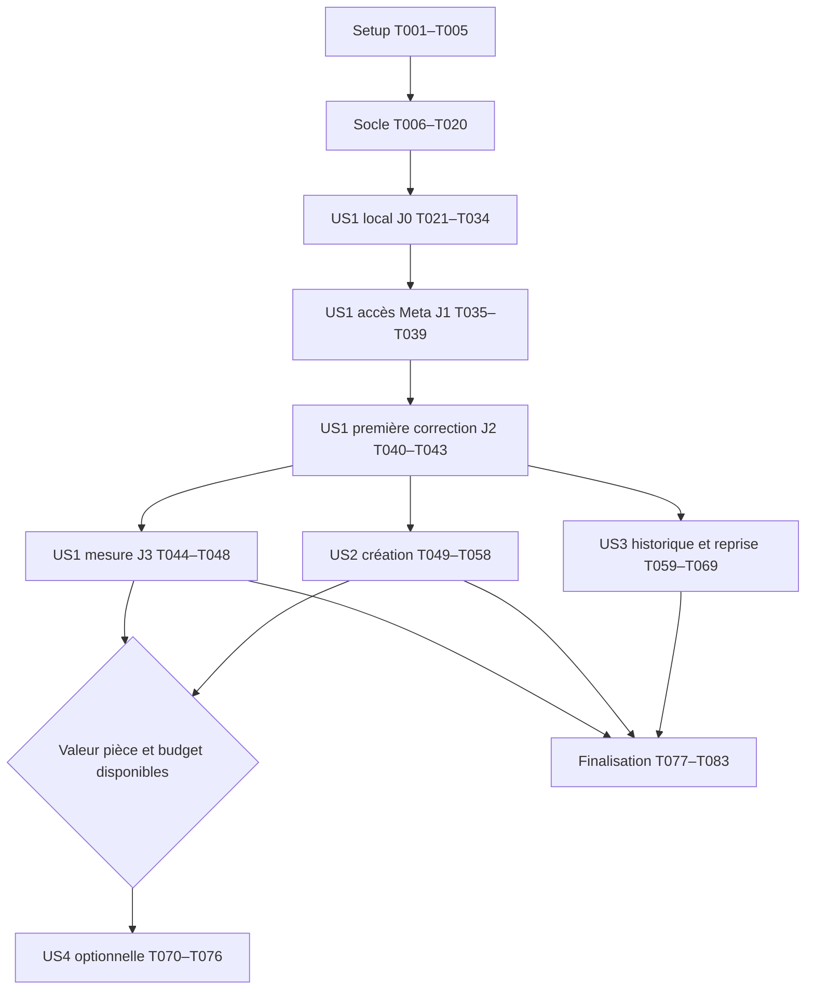

> **Mise à jour utilisateur du 2026-10-28** : plafond de consommation API de **150 USD encore disponibles**, suivi directement en micro-USD ; modèle `muse-spark-1.3-contributor` autorisé explicitement. La confirmation du solde restant est enregistrée une seule fois, sans recharge lors d’une nouvelle session. Cette instruction remplace les anciennes règles Standard/EUR et le blocage faute d’antériorité/changement/frais ; la clé reste dans `.env`, côté Python.

# Tasks: Agent de création et de contrôle visuel HDRP

**Input** : documents de `specs/003-hdrp-scene-agent/`.

**Prerequisites** : [plan.md](plan.md), [spec.md](spec.md), [research.md](research.md), [data-model.md](data-model.md), [contrats](contracts/editor-bridge.md), [quickstart.md](quickstart.md).

**Created** : 2026-10-28.

**Statut** : T001–T044 réalisées. J0 et J1 réels vérifiés ; J2 a appliqué un patch choisi par Contributor, rebaké, comparé cinq vues et restauré la référence avec capture fraîche. Le premier candidat reste provisoire : l’utilisateur a signalé des fuites de lumière. Les essais locaux dirigés via MCP corrigent les coins (jugés propres) et le linteau, sans valider une réparation autonome des UV. Les anciennes mesures de performance doivent être requalifiées avec contrôle du focus. Consommation API globale : 0,012438 USD (diagnostics refusés compris), 149,987562 USD disponibles. Voir [implementation-status.md](implementation-status.md).

**Tests** : les scénarios d’acceptation, tests indépendants et cas négatifs explicitement décrits par la spécification motivent les tests de contrat/intégration ci-dessous. Ils ciblent les risques observables et les preuves demandées. Ils ne rajoutent pas une obligation de TDD à la constitution, qui est un gabarit non renseigné.

**Organization** : US1 = corriger une scène (P1), US2 = créer une pièce (P1), US3 = comprendre/comparer/annuler (P2), US4 = forêt (P3 conditionnelle). Le socle de budget et de restauration est indispensable à US1 ; US3 complète son interface et sa reprise opérateur.

## Format: `[ID] [P?] [Story] Description`

Chaque tâche porte une case, un ID séquentiel et un chemin exact. `[P]` désigne une possibilité de parallélisme **après les dépendances indiquées**, dans les groupes décrits en fin de document ; aucune obligation de lancer des sous-agents. Sans `[P]`, respecter l’ordre de la phase et les dépendances transversales. La génération ne lance aucun agent supplémentaire.

## Path Conventions

Chemins relatifs à la racine du workspace. Code Python dans `src/hdrp_agent/`, package dans `unity/Packages/com.hackathon.hdrp-agent/`, projet de recette dans `unity/HDRPValidation/`. Les chemins nouveaux ci-dessous précisent les modules internes du plan ; ils ne désignent pas des fichiers déjà présents.

`evaluation-private/` contient les oracles de recette et ne doit jamais entrer dans les prompts. `.hdrp-agent/` contient données locales et grand livre global persistant. Tous les appels réels, sondes incluses, partagent les **150 USD encore disponibles confirmés par l’utilisateur**. Les dépenses historiques sont hors de cette nouvelle portée de solde ; toute consommation externe postérieure doit être rapprochée, sans recharge du ledger.

## Phase 1: Setup (Shared Infrastructure)

**Purpose** : initialiser Python et Unity sans inférence, avec versions verrouillées.

- [X] T001 Initialiser Python 3.12, le package `hdrp_agent`, l’entrée CLI `hdrp-agent`, les dépendances du plan et les extras de validation dont `openapi-spec-validator` dans `pyproject.toml`, `uv.lock` et `src/hdrp_agent/__init__.py` ; enregistrer les versions effectivement résolues.

- [X] T002 [P] Configurer exclusions des secrets, `.hdrp-agent/`, `evaluation-private/` et caches Unity sans ignorer les `.meta` de sources dans `.gitignore` ; ne pas modifier `.env` ni initialiser une branche Git ; dépend de T001.

- [X] T003 [P] Créer le package Unity local, ses assemblages Editor/Runtime et tests compatibles Unity 6000.3 dans `unity/Packages/com.hackathon.hdrp-agent/package.json`, `unity/Packages/com.hackathon.hdrp-agent/Editor/HdrpAgent.Editor.asmdef`, `unity/Packages/com.hackathon.hdrp-agent/Runtime/HdrpAgent.Runtime.asmdef`, `unity/Packages/com.hackathon.hdrp-agent/Tests/Editor/HdrpAgent.Editor.Tests.asmdef` et `unity/Packages/com.hackathon.hdrp-agent/Tests/Runtime/HdrpAgent.Runtime.Tests.asmdef` ; dépend de T001.

- [X] T004 Créer le projet HDRP de recette sous Metal et verrouiller Unity 6000.3.23f1, HDRP 17.3.0 et le package local dans `unity/HDRPValidation/ProjectSettings/ProjectVersion.txt`, `unity/HDRPValidation/Packages/manifest.json` et `unity/HDRPValidation/Packages/packages-lock.json` ; conserver les fichiers de projet réellement générés ; dépend de T003.

- [X] T005 Définir brief de pièce, plan trois vues de travail/deux de contrôle et trajet six secondes/24 fps à 1280×720 dans `fixtures/briefs/room.json`, `fixtures/inspection-plans/room.json` et `config/defaults.json` ; fixer EV, graines, chauffe 32–120 frames, trois essais, 1200 s/session et 600 s/bake ; dépend de T001, T004.

**Checkpoint** : dépendances résolues, projet ouvrable et package compilable ; aucun accès Meta nécessaire.

## Phase 2: Foundational (Blocking Prerequisites)

**Purpose** : modèles partagés, état durable, budget et transport. Terminer ce socle avant toute story et avant toute sonde payante.

- [X] T006 Écrire la validation formelle des contrats JSON Schema 2020-12/OpenAPI 3.1, références, schémas partagés et payloads invalides dans `tests/contract/test_design_contracts.py` à partir de `specs/003-hdrp-scene-agent/contracts/domain.schema.json` et `specs/003-hdrp-scene-agent/contracts/http-api.openapi.json` ; corriger tout défaut réel du contrat ; dépend de T001.

- [X] T007 Implémenter DTO Pydantic stricts et types partagés Project/Scene/Session/Command/Artifact/Budget dans `src/hdrp_agent/domain.py` ; fermer les champs, conserver unités et null explicites, compléter les validations relationnelles et distinguer booléen/nombre ; dépend de T006.

- [X] T008 Créer stockage SQLite avec clés étrangères, schéma versionné, journal d’événements, file de commandes, reçus, versions et grand livre global dans `src/hdrp_agent/store.py` ; transactions courtes, écritures atomiques et aucune remise à zéro lors d’une nouvelle scène ; dépend de T007.

- [X] T009 [P] Implémenter configuration explicite des secrets, jeton loopback, racines autorisées, filtrage des logs et diagnostic offline dans `src/hdrp_agent/config.py`, `src/hdrp_agent/logging.py` et `src/hdrp_agent/doctor.py` ; aucune clé dans les réponses ou rapports ; dépend de T008.

- [X] T010 [P] Implémenter artefacts immuables SHA-256, écritures atomiques, limites 10 MB image/JSON et 20 MB MP4, métadonnées de provenance et cache indexé par toutes les empreintes pertinentes dans `src/hdrp_agent/artifacts.py` ; refuser chemins/symlinks hors racines ; dépend de T008.

- [X] T011 Implémenter réservations atomiques `BEGIN IMMEDIATE`, règlement remplaçant réserve, inconnus conservés, majorants Spark/SAM, conversion Decimal arrondie au supérieur et plafond 150000000 micro-dollars USD dans `src/hdrp_agent/budget.py` ; geler le live si tarif, solde de départ confirmé ou coût maximal est inconnu ; dépend de T009, T010.

- [X] T012 Implémenter lecture budget, rapprochement externe cumulatif et configuration tarifaire sourcée/datée dans `src/hdrp_agent/budget_cli.py` et `config/meta-contributor.json` ; exposer `budget show`, `budget reconcile`, `pricing refresh`, vérifier les sources à l’exécution et ne jamais créer 150 USD restants de nouveau solde ; dépend de T011.

- [X] T013 Implémenter file persistante, claims limités à un, epoch, idempotence par hash, directives continue/cancel et passage unknown sans rejeu après perte de reçu dans `src/hdrp_agent/command_queue.py` ; inspection permise pour réconciliation, mutation bloquée si recovery_required ; dépend de T008, T011.

- [X] T014 Implémenter client loopback Unity, DTO fermés, polling non bloquant, battements, reçus hors Library et gestion des rechargements de domaine dans `unity/Packages/com.hackathon.hdrp-agent/Editor/BridgeClient.cs` et `unity/Packages/com.hackathon.hdrp-agent/Editor/BridgeDtos.cs` ; ne jamais interpréter un délai natif comme une permission de rejouer ; dépend de T007, T013.

- [X] T015 Créer répartiteur de commandes sur thread principal et registre de capacités dans `unity/Packages/com.hackathon.hdrp-agent/Editor/CommandExecutor.cs` ; vérifier epoch/version, persister commencé/terminé, refuser kind ou opération non implémentée et réserver le contrôle de cancellation aux callbacks ; dépend de T014.

- [X] T016 Exposer health, inscription projet, bridge poll/progress/result, artefacts et budget conformément aux contrats dans `src/hdrp_agent/api.py` ; jeton Bearer, un worker, coroutine durable via lifespan, limites de corps et idempotence sans transaction ouverte pendant réseau ; dépend de T010, T012, T013, T015.

- [X] T017 [P] Tester admissions concurrentes, coûts inconnus, réponse invalide facturée, timeout réservé, règlement sans double compte, change/frais et rapprochement externe répété dans `tests/unit/test_budget.py` et `tests/integration/test_budget_persistence.py` ; dépend de T016.

- [X] T018 [P] Tester reçu répété, payload contradictoire, ancien epoch, domain reload et annulation avec battements retardés dans `unity/Packages/com.hackathon.hdrp-agent/Tests/Editor/BridgeReceiptTests.cs` et `tests/integration/test_command_queue.py` ; aucune mutation automatique doublée ; dépend de T016.

- [X] T019 Brancher `serve`, `doctor --offline` et le diagnostic des répertoires au CLI dans `src/hdrp_agent/cli.py` ; fournir un fournisseur simulé explicite dans `src/hdrp_agent/providers/fake.py` et marquer les traces offline sans aucun verdict de réparation réelle ; dépend de T017, T018.

- [X] T020 Exécuter validation formelle des contrats, tests du socle et handshake Unity/service sans inférence, puis consigner résultats et éventuelles limitations dans `.hdrp-agent/reports/foundation.md` ; ne pas ouvrir le live tant que les contrôles financiers échouent ; dépend de T019.

**Checkpoint** : protocoles, stockage et admission financière opérationnels ; aucun appel payant requis pour ce checkpoint. La capture/bake réelle est qualifiée dans J0 ci-dessous.

## Phase 3: User Story 1 — Corriger l’éclairage d’une scène existante (Priority: P1) — MVP

**Goal** : inspecter une pièce, étayer une hypothèse, appliquer une correction réelle puis comparer/restaurer sous limites.

**Independent Test** : pièce avec défaut connu seulement de l’évaluateur ; trois vues de travail, clip et deux vues de contrôle ; correction sans réglage manuel entre essais, vrai bake si requis, rejet d’une régression et preuve de la version retenue. La campagne complète teste trois cas, avec au moins deux réussites en trois essais/cas au maximum.

### Tests for User Story 1

Écrire les scénarios avant les services correspondants ; les faire passer après implémentation. Un échec d’import seul n’est pas une preuve du comportement attendu.

- [X] T021 [P] [US1] Définir tests des parcours inspection/session/stop et schémas de diagnostic/proposition dans `tests/contract/test_inspection_api.py` et `tests/integration/test_inspection_flow.py` ; couvrir sortie invalide, version ancienne, critères gelés et exclusion des contrôles/oracles des prompts ; dépend de T020.

- [X] T022 [P] [US1] Définir tests EditMode des copies de dépendances/GUID, allowlist, unités, patch partiel et restauration post-bake dans `unity/Packages/com.hackathon.hdrp-agent/Tests/Editor/SceneMutationTests.cs` ; aucune écriture sur l’original ou hors scope ; dépend de T020.

- [X] T023 [P] [US1] Définir tests graphiques PlayMode de stabilité, fin de frame, ordre des images et témoins incomparables dans `unity/Packages/com.hackathon.hdrp-agent/Tests/Runtime/CapturePipelineTests.cs` ; séparer les tests batch EditMode, sans exiger de capture GameView headless ; dépend de T020.

### Implementation for User Story 1 — J0 local

- [X] T024 [US1] Implémenter copie isolée de scène, clonage des assets mutables, nouveaux GUID et manifeste de snapshots avant/après avec lightmaps, LightingDataAsset, probes et `.meta` dans `unity/Packages/com.hackathon.hdrp-agent/Editor/SnapshotStore.cs` ; restauration conditionnelle et journal de conflit ; dépend de T022.

- [X] T025 [US1] Exporter scène/capacités, géométrie, lights, volumes, matériaux, GI et bake dans `unity/Packages/com.hackathon.hdrp-agent/Editor/SceneInspector.cs` ; sérialiser logical keys et source/working GlobalObjectId dans `unity/Packages/com.hackathon.hdrp-agent/Runtime/CaptureBinding.cs`, avec résolution de la copie uniquement en EditMode ; dépend de T024.

- [X] T026 [US1] Implémenter transforms, lumière, fog, matériau local, contribution GI et paramètres de bake dans `unity/Packages/com.hackathon.hdrp-agent/Editor/PatchExecutor.cs` ; suivre bornes du contrat dont mean_free_path ≥1 m, max huit opérations, recalculer besoin de bake et restaurer après échec partiel ; dépend de T025.

- [X] T027 [US1] Implémenter Progressive GPU et suivi de job dans `unity/Packages/com.hackathon.hdrp-agent/Editor/BakeController.cs` ; ne valider que bakeCompleted du job courant avec ressources, gérer Cancel/deadline et attendre l’arrêt réel avant retour de fichiers ; dépend de T026.

- [X] T028 [US1] Implémenter rig GameView avec caméra unique, temps à 24 fps, poses indexées, exposition fixe, graines, reset/chauffe et capture en fin de frame dans `unity/Packages/com.hackathon.hdrp-agent/Runtime/CaptureRig.cs` ; conserver ordre logique et erreurs de readback ; ajouter `Runtime/PerformanceSampler.cs` pour collecter 120 frames hors capture/encodage, avant tout verdict de performance ; dépend de T023, T027.

- [X] T029 [US1] Piloter transitions EditMode/PlayMode, bindings, collecte PNG, manifeste de conditions et rôles work/control dans `unity/Packages/com.hackathon.hdrp-agent/Editor/CaptureController.cs` ; timeout si GameView ne rend pas, mémoire/readbacks bornés, reprise interrompue sans preuve fictive ; dépend de T028.

- [X] T030 [US1] Assembler MP4/H.264 sans audio depuis PNG complets, vérifier frame count/durée et préparer crops/frames horodatées avec remapping dans `src/hdrp_agent/media.py` ; garder les originaux et refuser frame manquante plutôt que l’interpoler ; dépend de T029.

- [X] T031 [US1] Implémenter comparabilité et témoin répété dans `src/hdrp_agent/capture_validation.py` ; contrôler versions, hashes de dépendances, conditions, état bake et différence de luminance linéarisée ≤0,01 sur zones stables, seuil gelé avant essais et non concluant après chauffe maximale ; dépend de T030.

- [X] T032 [US1] Créer menu Prepare Room et fixture neutre aux UV valides dans `unity/Packages/com.hackathon.hdrp-agent/Editor/ValidationRoomBuilder.cs` ; produire `unity/HDRPValidation/Assets/AgentWorkspace/Room.unity`, ressources originales autorisées et variantes A/B/C dont oracles uniquement dans `evaluation-private/room-oracles.json` ; dépend de T031.

- [X] T033 [US1] Créer fenêtre de brief, capacités, mode offline/live, limites, diagnostic, progression et aperçu avant/après dans `unity/Packages/com.hackathon.hdrp-agent/Editor/AgentWindow.cs` ; brancher menus Window/Validate Local Pipeline et ne pas annoncer de gain sur données simulées ; dépend de T032.

- [X] T034 [US1] Exécuter J0 graphique : deux captures témoins, vrai bake GPU, mutation locale de test, restauration des fichiers/références puis nouvelle capture ; écrire preuves et état matériel dans `.hdrp-agent/reports/j0-local-pipeline.json` ; consigner séparément capture_verified et gpu_bake_verified, fermer les parcours non validés sans inventer de fallback CPU ; dépend de T033.

### Implementation for User Story 1 — J1 Meta

Les appels live ne sont autorisés qu’après J0 pertinent réussi et configuration financière réconciliée. La génération actuelle n’exécute pas ces étapes.

- [X] T035 [US1] Implémenter Responses Muse Spark avec transport sans retry, aucun outil/conversation/historique implicite, truncation disabled, JSON strict et max_output_tokens=4096 dans `src/hdrp_agent/providers/meta_responses.py` ; admission au majorant avant envoi, lecture output_text terminal et règlement même si contenu invalide ; dépend de T021, T033.

- [X] T036 [US1] Implémenter SAM image ciblée et vidéo optionnelle, parseur officiel, ordonnancement des frames, association incertaine aux objets et cache dans `src/hdrp_agent/providers/sam_decoder.py` et `src/hdrp_agent/segmentation.py` ; repli moteur, résultat vide valide et masques sans diagnostic causal ; dépend de T035.

- [X] T037 [US1] Construire prompts de diagnostic/proposition et validations sémantiques ModelDiagnosis/ModelProposal dans `src/hdrp_agent/planner.py` et `src/hdrp_agent/prompts.py` ; preuves et cibles existantes, faits/hypothèses distincts, diagnostics ciblés si besoin, aucun oracle ni pixels/scores de contrôle transmis ; dépend de T036.

- [X] T038 [US1] Brancher immédiatement la commande CLI `probe` dans `src/hdrp_agent/cli.py`, puis implémenter sondes `core`, gestion des uploads distants possédés et nettoyage, enveloppe minimum entre part sondes/5 USD/disponible et rapprochement d’usage dans `src/hdrp_agent/probes.py` ; vidéo native seulement si majorant établi, sinon repli horodaté explicite ; dépend de T037.

- [X] T039 [US1] Exécuter J1 avec accès réel et budget réconcilié : image Spark JSON strict, segmentation décodée, vidéo si admissible ; enregistrer IDs, usages, coûts et capacités dans `.hdrp-agent/reports/j1-meta-probes.json` ; toute indisponibilité reste non validée et n’autorise pas une démo simulée présentée live ; dépend de T038 ; requiert capture_verified pour les médias Unity, sans imposer un bake pour les sondes non liées à la GI.

### Implementation for User Story 1 — J2 boucle et première preuve

- [X] T040 [US1] Implémenter évaluateur séparé dans `src/hdrp_agent/evaluation.py` : registre fermé de méthodes, refus des méthodes inconnues et entrées manquantes, seuils préfixés, défaut local, visibilité, contraintes artistiques/géométriques, contrôles et performance sans readback ; avis humain obligatoire manquant = verdict provisoire, saisir ces avis via fichiers de revue locaux validés dans `.hdrp-agent/reviews/` ; dépend de T031, T037.

- [X] T041 [US1] Implémenter automate durable et essais correctifs dans `src/hdrp_agent/orchestrator.py` : baseline, diagnostic, snapshot, patch, bake, captures, vérification, meilleur état et retour ; consommer ordinal dès acceptation durable, arrêt à trois/limites/incertitude et aucun rejeu d’issue inconnue ; dépend de T038, T040.

- [X] T042 [US1] Exposer création/lecture/arrêt de session et rapport minimal dans `src/hdrp_agent/api.py` et `src/hdrp_agent/reporting.py` ; brancher le panneau et CLI reports export dans `unity/Packages/com.hackathon.hdrp-agent/Editor/AgentWindow.cs` et `src/hdrp_agent/cli.py` ; préserver les preuves après toute interruption ; dépend de T041.

- [X] T043 [US1] Exécuter une correction réelle J2 sur défaut caché à l’agent, vérifier scène depuis une autre caméra et conserver comparaison alignée, patch, bake et verdict dans `.hdrp-agent/reports/j2-first-correction.json` ; aucune valeur de correction codée à partir de l’oracle ; dépend de T039, T042 ; requiert capture_verified et gpu_bake_verified pour tout cas indirect, sinon démonstration temps réel explicitement partielle.

### Validation for User Story 1 — J3 valeur et limites

- [X] T044 [US1] Compléter et exécuter tests de sortie modèle tronquée/invalide, masque erroné, réponse facturée sans correction, contrôles filtrés et refus du quatrième essai dans `tests/integration/test_inspection_flow.py` et `tests/contract/test_provider_payloads.py` ; utiliser fixtures nettoyées dans `fixtures/provider-replies/` sans appel live implicite ; dépend de T042.

- [ ] T045 [US1] Exécuter les trois variantes A/B/C avec critères gelés, vrais bakes requis et preuves cinq vues/clip par version dans `.hdrp-agent/reports/room-campaign.json` ; mesurer SC-001/SC-002 avec cible ≥2/3 en ≤3 essais et conserver tous les échecs ; dépend de T043, T044.

- [ ] T046 [US1] Exécuter les quatre négatifs image ancienne/bake incomplet/assombrissement hors brief/amélioration une seule vue dans `tests/integration/test_false_gains.py` et `.hdrp-agent/reports/false-gains.json` ; aucun admis, retour complet prouvé et avis humain non remplacé par vote modèle ; dépend de T045.

- [ ] T047 [US1] Brancher `evaluate --suite room` et `evaluate --suite sam-ablation` dans `src/hdrp_agent/cli.py`, puis implémenter collecte et comparaison des trois tâches du workflow habituel dans `src/hdrp_agent/benchmarks.py` et `.hdrp-agent/reports/workflow-baseline.json` ; prompts/temps/coûts réels, qualité à l’aveugle, réduction médiane cible 50 %, baseline absente ou nulle = non concluante ; dépend de T046.

- [ ] T048 [US1] Comparer dix régions identiques moteur seul/moteur+SAM via `src/hdrp_agent/benchmarks.py` et `.hdrp-agent/reports/sam-ablation.json` ; justesse, IoU seulement pertinente, corrections, temps et coût incrémental, résultat négatif conservé et aucun bénéfice présumé ; dépend de T047.

**Checkpoint MVP** : US1 utilisable sans US2/US3/US4 ; budget et restauration de base déjà présents. J0/J1 sont des portes matérielles/fournisseur, J2 la première preuve, J3 la mesure de valeur. Un seuil manqué est rapporté comme tel, pas transformé en réussite.

## Phase 4: User Story 2 — Construire une pièce et contrôler son rendu (Priority: P1)

**Goal** : créer une petite pièce depuis brief et ressources autorisées puis réutiliser la boucle de contrôle.

**Independent Test** : depuis une scène initiale sauvegardée et des ressources connues, construire tous les éléments requis, inspecter/corriger, rouvrir depuis une caméra libre. Asset absent explicite ; ≥4/5 évaluateurs reconnaissent l’ambiance sans dégradation des contraintes obligatoires.

### Tests for User Story 2

- [ ] T049 [P] [US2] Définir tests de création réelle, ressource absente, fallback géométrique explicite, limite de construction et passage obligatoire par inspection dans `tests/integration/test_room_creation.py` ; ne pas confondre création initiale et trois essais correctifs ; dépend de T043.

- [ ] T050 [P] [US2] Définir tests EditMode des primitives/prefabs, propriété du root, nouvelles clés, supports/intersections et suppression au retour dans `unity/Packages/com.hackathon.hdrp-agent/Tests/Editor/RoomConstructionTests.cs` ; dépend de T043.

### Implementation for User Story 2

- [ ] T051 [US2] Créer catalogue de ressources autorisées avec dimensions, IDs et droits, incluant préfabs originaux spot/volume et géométrie simple, dans `src/hdrp_agent/asset_catalog.py` et `fixtures/assets/room-catalog.json` ; aucun achat/download implicite et aucune solution de fixture divulguée ; dépend de T049, T050.

- [ ] T052 [US2] Préciser contrat ModelConstruction avant code dans `specs/003-hdrp-scene-agent/contracts/domain.schema.json`, `specs/003-hdrp-scene-agent/contracts/http-api.openapi.json` et `specs/003-hdrp-scene-agent/contracts/provider.md` : layout typé depuis brief, IDs catalogue, max quatre lots de huit opérations initiales, références parent/enfant validées ; garder les schémas synchronisés et le constructeur distinct d’un diagnostic de défaut ; dépend de T051.

- [ ] T053 [US2] Implémenter constructeur borné et planification Meta du layout dans `src/hdrp_agent/room_builder.py` ; réservations pour chaque appel, construction initiale tracée sans consommer l’ordinal correctif, arrêt propre à la limite et inspection de la baseline créée avant remise ; dépend de T052.

- [ ] T054 [US2] Implémenter validation du placement par dimensions, bounds et données de support dans `src/hdrp_agent/geometry.py` ; écart de référence ≤2 cm et intersections selon critères gelés, sans substituer ces mesures au contrôle du rendu ; dépend de T053.

- [ ] T055 [US2] Ajouter opérations create_primitive/instantiate_prefab et inspection support/overlap dans `unity/Packages/com.hackathon.hdrp-agent/Editor/ConstructionExecutor.cs` ; annoncer capacités dans le registre, utiliser root possédé et snapshot pour retour de la construction partielle ; dépend de T054.

- [ ] T056 [US2] Intégrer mode create_room, catalogue/dépendances et brief dans `src/hdrp_agent/orchestrator.py` et `unity/Packages/com.hackathon.hdrp-agent/Editor/AgentWindow.cs` ; résultat partiel visible et même boucle de vérification après création ; dépend de T055.

- [ ] T057 [US2] Exécuter création depuis brief, objet flottant/intersection puis ressource absente dans `tests/integration/test_room_creation.py` et `.hdrp-agent/reports/room-creation.json` ; démontrer les changements dans la scène rouverte et la conservation des limites/budget ; dépend de T056.

- [ ] T058 [US2] Recueillir les cinq avis d’ambiance/conformité et finaliser SC-003 dans `.hdrp-agent/reports/room-human-review.json` ; ≥4/5 cible, absence d’avis = recette non concluante, provenance des médias et contraintes obligatoires inchangées ; dépend de T057.

**Checkpoint** : le parcours création se teste depuis un projet propre ; il dépend des services d’inspection d’US1, pas de son interface avancée d’historique.

## Phase 5: User Story 3 — Comprendre, comparer et annuler les essais (Priority: P2)

**Goal** : consulter l’historique, comparer les mêmes vues, restaurer et reprendre proprement après incident, avec visibilité financière.

**Independent Test** : essai utile, essai régressif, interruption/redémarrage ; meilleures versions et reçus conservés, restauration conditionnelle, comparaison sans confusion de version, réservations inconnues maintenues et aucun nouvel appel dépassant les 150 USD restants.

### Tests for User Story 3

- [ ] T059 [P] [US3] Définir tests de rapport historique, correspondance caméra/version/conditions, défauts non résolus, état offline et absence de secrets dans `tests/contract/test_reports_api.py` et `tests/integration/test_history.py` ; dépend de T043.

- [ ] T060 [P] [US3] Définir tests crash/reprise, timeout après envoi, reçu présent/absent et limites persistantes dans `tests/integration/test_recovery.py` ; mêmes réservations et ordinal après redémarrage, aucun renvoi implicite ; dépend de T043.

- [ ] T061 [P] [US3] Définir tests de restauration opérateur avec conflit concurrent, ressources partagées et bake encore actif dans `unity/Packages/com.hackathon.hdrp-agent/Tests/Editor/RecoveryTests.cs` ; aucune restauration aveugle ni suppression hors propriété ; dépend de T043.

### Implementation for User Story 3

- [ ] T062 [US3] Étendre rapports persistants et export local avec versions/diagnostics/patchs/preuves/rejets/coûts dans `src/hdrp_agent/reporting.py` et `src/hdrp_agent/report_templates/session.html` ; distinguer journal incomplet, provenance et limite, sans réutiliser le rapport opérateur dans les prompts ; dépend de T059.

- [ ] T063 [US3] Créer navigation d’historique et comparaison côte à côte de mêmes vues dans `unity/Packages/com.hackathon.hdrp-agent/Editor/HistoryPanel.cs` ; filtrer par essai/version, afficher hypothèse vs observation, motif de retour et défauts restants ; dépend de T062.

- [ ] T064 [US3] Implémenter restauration demandée via API et panneau dans `src/hdrp_agent/api.py` et `unity/Packages/com.hackathon.hdrp-agent/Editor/RecoveryPanel.cs` ; expected_version et manifeste obligatoires, attendre arrêt du bake puis vérifier références/hashes et recapturer ; dépend de T061, T063.

- [ ] T065 [US3] Implémenter rapprochement de reçus après redémarrage et récupération explicite dans `src/hdrp_agent/recovery.py` ; seul inspect/réconciliation/retour conditionnel autorisé en recovery_required, aucun patch/bake/appel fournisseur rejoué automatiquement ; dépend de T060, T064.

- [ ] T066 [US3] Afficher arrêt en cours, annulation native différée, temps consommé et état financier dans `unity/Packages/com.hackathon.hdrp-agent/Editor/BudgetPanel.cs` et `unity/Packages/com.hackathon.hdrp-agent/Editor/AgentWindow.cs` ; unknown_reserved est inclus dans active_reserved, jamais additionné deux fois ; dépend de T065.

- [ ] T067 [US3] Finaliser consultation/export/reprise CLI dans `src/hdrp_agent/cli.py` et `src/hdrp_agent/budget_cli.py` ; retrouver meilleure version et justificatifs après réouverture, préserver le rapprochement cumulatif et les rapports après limite ; dépend de T066.

- [ ] T068 [US3] Exécuter tests US3 et une reprise Unity réelle après interruption avec reçus, captures et fichiers conservés dans `.hdrp-agent/reports/recovery-validation.json` ; une issue absente reste recovery_required, ne pas cocher une restauration seulement supposée ; dépend de T067.

- [ ] T069 [US3] Exécuter SC-006 : dépassement/coût inconnu, admissions concurrentes, issue facturation inconnue après restart et quatrième essai refusé dans `.hdrp-agent/reports/limits-validation.json` ; utiliser scénarios simulés explicitement pour provoquer les risques sans dépenses incontrôlées ; dépend de T068.

**Checkpoint** : US3 se vérifie avec un historique US1 ou des événements de test étiquetés, sans construire une pièce ou une forêt. Les preuves de restauration réelle utilisent Unity ; les fixtures seules ne prouvent pas le rendu.

## Phase 6: User Story 4 — Étendre le contrôle à une forêt (Priority: P3, extension)

**Goal** : construire/inspecter plusieurs zones d’une petite forêt avec terrain et ressources autorisées.

**Activation** : US1 et US2 validées avec résultats utiles et budget restant suffisant. Ne pas retarder la livraison du prototype pièce pour cette extension. Si la condition n’est pas remplie, laisser les tâches non cochées et documenter l’extension non livrée ; ne pas annoncer toute la spécification terminée.

**Independent Test** : terrain et ressources compatibles, placement sans flottement/intersection indésirable, ambiance/performance conservées sur plusieurs zones et retour disponible. Sans asset/capacité, limitation explicite.

### Tests for User Story 4

- [ ] T070 [P] [US4] Définir tests du constructeur forêt, placement reproductible, terrain, budget/limites et dépendance absente dans `tests/integration/test_forest_extension.py` ; réutiliser contrats/corrections existants sans prétendre produire des assets manquants ; dépend de T048, T058.

- [ ] T071 [P] [US4] Préparer catalogue végétation autorisée, terrain de recette et brief multizone dans `fixtures/assets/forest-catalog.json`, `fixtures/briefs/forest.json` et `fixtures/inspection-plans/forest.json` ; consigner droits et distinguer primitives de démonstration d’assets réalistes ; dépend de T048, T058.

### Implementation for User Story 4

- [ ] T072 [US4] Implémenter construction forêt bornée depuis catalogue et terrain dans `src/hdrp_agent/forest_builder.py` ; fixer au plus 32 instances en quatre lots de huit opérations initiales, avec graine et budget de rendu préfixés, puis réutiliser la boucle d’inspection et les mêmes majorants API ; dépend de T070, T071.

- [ ] T073 [US4] Ajouter données de support terrain/chevauchement et création contrôlée des instances dans `unity/Packages/com.hackathon.hdrp-agent/Editor/ForestInspector.cs` ; ne pas modifier shaders arbitraires, signaler feuillage/transparences non associés et contrôler/fixer le vent pour comparabilité ; dépend de T072.

- [ ] T074 [US4] Brancher mode create_forest et ses capacités/limites dans `src/hdrp_agent/orchestrator.py` et `unity/Packages/com.hackathon.hdrp-agent/Editor/AgentWindow.cs` ; extension désactivée si ressources ou preuve préalable manquent ; dépend de T073.

- [ ] T075 [US4] Intégrer inspection multizone, répétitions visibles, matériaux et performance dans `src/hdrp_agent/evaluation.py` et `fixtures/inspection-plans/forest.json` ; contrôles séparés du choix de patch, mêmes exigences de preuve et de retour ; dépend de T074.

- [ ] T076 [US4] Exécuter recette graphique forêt avec cas positif, régression autre zone et ressource manquante dans `.hdrp-agent/reports/forest-validation.json` ; enregistrer limites et coûts réels et garder résultat partiel si capacités insuffisantes ; dépend de T075.

**Checkpoint** : extension testée indépendamment sur ses ressources ; aucun résultat forêt n’est requis pour démontrer US1 seule.

## Phase 7: Polish & Cross-Cutting Concerns

**Purpose** : livraison reproductible des stories retenues et preuve publique préparée localement. Cette phase n’attend pas US4 si l’extension n’est pas activée.

- [ ] T077 [P] Rédiger installation, architecture réelle, droits des ressources, modèles Meta, limites et périmètre effectivement livré dans `README.md`, `docs/provenance.md` et `docs/limitations.md` ; distinguer code nouveau, capacités documentées, tests exécutés et résultats manquants ; dépend de T048.

- [ ] T078 [P] Consolider les résultats SC-001 à SC-007 et avis humains dans `.hdrp-agent/reports/acceptance-summary.json` ; citer preuves source, baseline et ablation, marquer tout seuil raté/non mesuré et ne pas transformer l’absence d’évaluateur en succès ; dépend de T048, T058, T069.

- [ ] T079 Mesurer temps de capture/assemblage, inspection hors bake, frame time hors readback et durées de bake dans `.hdrp-agent/reports/performance.json` ; ajuster seulement cache/file/readback dans `src/hdrp_agent/media.py` et `unity/Packages/com.hackathon.hdrp-agent/Editor/CaptureController.cs` sans changer critères, puis revérifier les comparaisons affectées ; dépend de T069.

- [ ] T080 Vérifier contrats finaux, schémas provider/constructeur, routes effectives, nettoyage des fichiers distants possédés et expurgation des secrets dans `tests/contract/test_design_contracts.py`, `tests/contract/test_provider_payloads.py` et `.hdrp-agent/reports/contract-validation.json` ; inclure US4 seulement si activée ; dépend de T079.

- [ ] T081 Exécuter le quickstart des stories livrées, tests Python, tests Unity EditMode puis captures PlayMode graphiques, et corriger commandes/attendus réellement divergents dans `specs/003-hdrp-scene-agent/quickstart.md` ; conserver résultats dans `.hdrp-agent/reports/quickstart-validation.json`, jamais une simple liste de commandes non exécutées ; dépend de T077, T078, T080.

- [ ] T082 Préparer démonstration locale trois minutes et protocole SC-008 dans `docs/demo-script.md` et `.hdrp-agent/reports/demo-review.json` ; montrer défaut/hypothèse/changement/contrôles/verdict, indiquer coupes et durées et recueillir cinq avis avec cible ≥4/5 sans publication automatique ; dépend de T081.

- [ ] T083 Assembler manifeste de livraison avec lockfiles, chemins de preuves, ledger réconcilié, résultats de reprise, coûts, limites et état des tâches conditionnelles dans `.hdrp-agent/reports/delivery-manifest.json` ; ne cocher que travaux réellement terminés dans `specs/003-hdrp-scene-agent/tasks.md` ; dépend de T082.

## Dependencies & Execution Order

### Phase Dependencies

Setup T001–T005 → socle T006–T020 → US1 T021–T048. US2 utilise la boucle US1 dès sa première preuve T043, mais l’ordre de livraison recommandé termine d’abord J3/T048. US3 peut être développé et testé sur le même socle US1 après T043, sans dépendance à la création US2. Cette souplesse ne permet pas d’exécuter deux mutations dans le même éditeur.

La finalisation complète T078 attend US1/US2/US3 ; la documentation T077 et la préparation de démo peuvent commencer sur le MVP. US4 attend T048 + T058 et sa condition d’activation ; T083 peut livrer le périmètre pièce sans attendre T070–T076, qui restent alors non cochées et explicitement hors livraison.

### User Story Dependencies

### Within Each User Story

Les tâches de test précèdent les composants concernés ; les scénarios GPU sont exécutés après leur implémentation dans l’éditeur graphique. Les contrats/modèles précèdent services et intégration. Les portes J0/J1 ferment uniquement le parcours non validé, sans faire passer une simulation pour une preuve réelle. Une demande d’avis artistique est une étape de recette prévue, pas une autorisation de modifier manuellement les réglages pendant la mesure.

Les dépendances listées sur les tâches sont des prérequis explicites. Les codes fournisseur/orchestrateur et tests offline (T035–T038, T040–T042, T044) peuvent avancer après leurs dépendances logicielles sans attendre une preuve d’accès live. En cas d’échec matériel ou fournisseur, conserver T034/T039/T043 non validées selon leurs résultats et poursuivre ces travaux indépendants ; aucun lancement live ne contourne les portes J0/J1. L’ordre séquentiel de chaque phase reste le défaut pour les tâches non `[P]`. Les branches US2/US3 ne sont ouvertes qu’après les prérequis du tableau ci-dessus ; toute modification d’un fichier partagé (`domain.py`, `api.py`, `orchestrator.py`, `AgentWindow.cs`, schémas) est sérialisée.

### Parallel Opportunities

| Groupe | Tâches | Dépendances communes terminées | Limite |
|---|---|---|---|
| Setup | T002, T003 | T001 | Fichiers séparés ; T004 attend T003 |
| Socle fichiers/configuration | T009, T010 | T008 | Pas d’écriture concurrente du même module |
| Vérification socle | T017, T018 | T016 | DB isolées pour tests ; un seul éditeur Unity |
| US1 tests | T021, T022, T023 | T020 | Jeux/tests séparés ; rendu graphique lancé seul |
| US2 tests | T049, T050 | T043 | Pas de deux mutations de la scène de recette |
| US3 tests | T059, T060, T061 | T043 | États de test isolés et ressources partagées verrouillées |
| US4 préparation | T070, T071 | T048, T058 et activation | Tests et catalogue distincts |
| Livraison | T077, T078 | Prérequis propres de chaque tâche | Lecture des mêmes preuves permise, pas d’écrasement |

Les marqueurs décrivent des possibilités d’ordonnancement ; ils n’autorisent pas à ignorer un prérequis ni à augmenter le nombre de sessions ou d’appels live concurrents.

## Parallel Example: User Story 1

Après T020, rédiger T021 (API/automate), T022 (mutations/snapshots) et T023 (capture) sur trois fichiers de tests distincts. Puis réaliser T024–T034 dans l’ordre pour qualifier le rendu et le bake avant les appels réels. Ne pas lancer plusieurs recettes GameView en parallèle.

## Parallel Example: User Story 2

Après T043, T049 couvre le service Python et T050 le constructeur Unity ; ces fichiers peuvent être préparés en parallèle. Le catalogue/contrat T051–T052 précède l’intégration de construction, et les changements à `orchestrator.py`/`AgentWindow.cs` attendent la fin des écritures US1/US3 sur ces fichiers.

## Parallel Example: User Story 3

Après T043, T059, T060 et T061 définissent indépendamment historique, reprise financière et restauration Unity. Sérialiser T062–T069 pour l’intégration des composants partagés. Les scénarios de crash utilisent des projets/DB de test isolés, jamais l’effacement du grand livre réel.

## Parallel Example: User Story 4

Après activation, préparer T070 (tests) et T071 (ressources/brief/plan) en parallèle. La construction T072 attend les deux ; toute capture forêt est exclusive avec la recette pièce et conserve le même ledger global.

## Implementation Strategy

### MVP First — User Story 1 Only

Livrer Setup + socle + US1 : **T001–T048**. Les points de preuve intermédiaires sont T034 (matériel local), T039 (accès réel), T043 (première correction), puis T048 (campagne et valeur). L’interface minimale, le rapport, le budget et le retour automatique sont inclus ; l’historique avancé, la construction et la forêt ne bloquent pas cette première démonstration. Le budget n’est jamais réinitialisé pour un jalon.

### Incremental Delivery

US1 → US2 (création de pièce) → US3 (consultation/reprise complète) → finalisation pièce. US3 peut être avancée après T043 si la priorité devient l’inspection d’un projet existant. US4 s’active après preuve utile sur pièce et ressources disponibles ; sa non-activation ne doit pas retarder le rendu de preuves US1. Aucun benchmark ni avis humain manquant n’est rempli avec une estimation présentée comme une mesure.

### Execution Limits

Ce fichier prépare l’implémentation, il ne la démarre pas. Lors de la réalisation, cocher une tâche seulement après code/artefacts et vérifications correspondants. Sans accès API, bake valide, dépenses réconciliées ou avis requis, conserver les tâches de preuve non terminées, produire les résultats partiels utiles et expliciter ce qui manque. Ne demander une information qu’au moment où elle devient nécessaire, sans interrompre les travaux indépendants.

## Coverage & Generation Validation

| Exigence | Tâches principales |
|---|---|
| FR-001 — Brief | T005, T007, T033, T042, T056 |
| FR-002 — Compatibilité | T004, T015, T025, T034 |
| FR-003 — Construction réelle | T049–T058 |
| FR-004 — Inspection multivue | T028–T032, T045 |
| FR-005 — Comparabilité | T023, T028–T031, T046 |
| FR-006 — Localisation | T025, T036–T037 |
| FR-007 — Diagnostic étayé | T021, T037, T043 |
| FR-008 — Segmentation | T036, T044, T048 |
| FR-009 — Critères gelés | T005, T007, T031, T040 |
| FR-010 — Correction | T022, T026, T041, T055 |
| FR-011 — Réversibilité | T022, T024, T034, T061, T064, T068 |
| FR-012 — Bake réel | T027, T034, T043, T046 |
| FR-013 — Vérification | T031, T040, T045–T046 |
| FR-014 — Régressions | T024, T040–T041, T046, T064 |
| FR-015 — Boucle bornée | T041, T044, T060, T069 |
| FR-016 — États/incertitudes | T007, T019, T037, T041–T042, T062 |
| FR-017 — Consultation/reprise | T008, T013–T018, T042, T059–T068 |
| FR-018 — Budget global | T011–T012, T017, T035, T038–T039, T060, T069 |
| FR-019 — Temps/cache | T005, T010, T027, T030, T036, T041, T079 |
| FR-020 — Meta/provenance | T035–T039, T051, T077, T080–T083 |
| FR-021 — Forêt | T070–T076 conditionnelles |

SC-001/002 : T045 ; SC-003 : T057–T058 ; SC-004 : T047 ; SC-005 : T046 ; SC-006 : T017/T044/T069 ; SC-007 : T048 ; SC-008 : T082.

Contrats : API commune T006/T016, inspection T021/T042, construction T049/T052, consultation/restauration T059/T064, provider T035–T039/T044, recette T045–T048/T057–T058/T068–T069/T076, contrôle final T080. Les entités partagées sont en T007–T010 ; observations/hypothèses/régions/essais/évaluations et leurs relations dans T036–T041 ; historique et rapports dans T062–T067.

Les vérifications de génération portent sur format des tâches, séquence des IDs, labels de story, chemins, références/dépendances sans cycle, couverture FR/SC et cohérence des groupes parallèles. Elles ne valident ni les contrats par exécution applicative ni la qualité d’un rendu. Hooks avant/après tâches : aucun fichier `.specify/extensions.yml` présent lors de la génération.

## Amendement utilisateur — une consigne, vérification globale automatique

Le 2026-10-28, l’utilisateur précise que le système doit repérer et traiter les défauts de toute la scène sans revue humaine entre chaque coin ou morceau de fenêtre. Le pilote manuel précédent ne constitue pas cette preuve. Ces tâches corrigent la boucle avant la campagne T045.

- [X] T084 Ajouter les tests de couverture de toutes les vues, de réinspection après patch, de poursuite sur candidat technique provisoire, d’absence de quatrième essai et d’un rapport final unique dans `tests/unit/test_planner.py` et `tests/integration/test_autonomous_cleanup.py`.
- [X] T085 Étendre les contrats et l’adaptateur avec une régénération UV2 bornée sur un clone possédé de mesh statique, sources préservées et rollback complet ; tests de bornes et d’isolation dans `tests/contract/` et `SceneMutationTests.cs`.
- [X] T086 Faire poursuivre la boucle sur des versions de travail provisoires quand seule la revue artistique manque ; réinspecter toutes les vues après chaque patch, conserver les diagnostics résiduels et restaurer la version admise à la fin si nécessaire, sans transformer le diagnostic modèle en validation artistique. Dépend de T084.
- [X] T087 Exporter les faits de mesh/UV/bake, fournir des frames horodatées du clip et exiger la couverture explicite des vues dans les diagnostics ; aucune référence privée ni vue de contrôle dans les prompts. Dépend de T084 et T085.
- [X] T088 Exécuter un essai live depuis une scène à plusieurs défauts avec une seule consigne et sans indication humaine intermédiaire, ≤3 patches, budget global et preuves conservées ; échec/limite explicites si nécessaire. Dépend de T085–T087. Exécuté avec résultat non concluant : essais et échecs conservés dans `.hdrp-agent/reports/autonomous-room-proof.json` ; aucun candidat validé ni réussite artistique déduite. Le dernier passage s’arrête avant patch sur une issue API inconnue, réservation maintenue.
- [ ] T089 Consolider le rapport final, l’attribution réelle, les défauts restants et une seule revue humaine du résultat ; mettre à jour les limites effectivement démontrées. Dépend de T088.

## Priorité utilisateur du 2026-10-29 — reproduction depuis images/vidéo

Le parcours décrit dans `reference-reconstruction.md` passe avant la campagne de correction d’éclairage ; les tâches et preuves antérieures restent conservées.

- [X] T090 Définir les contrats d’analyse et de composition, puis les tests de catalogue, calibration, médias, filtrage de la source et bornes des plans.
- [X] T091 Ajouter l’enregistrement préservant la scène actuelle et l’import de captures/vidéo avec timestamps et provenance.
- [X] T092 Intégrer analyse Muse, segmentation SAM bornée, catalogue local et proposition de composition sans transforms source ni valeurs d’éclairage source.
- [X] T093 Construire une scène distincte avec les prefabs/primitives proposés, matériaux possédés, caméra et éclairage ; reçus avant mutation et tests Unity.
- [X] T094 Boucler sur les rendus réels, conserver au plus six candidats (extension T102), comparer la référence et restaurer le meilleur sans annoncer de fidélité non prouvée.
- [X] T095 Brancher le parcours dans la fenêtre Unity et le service ; exécuter la démo réelle et archiver médias, propositions, coûts et limites.
- [X] T096 Après la revue utilisateur, ajouter et qualifier les gros plans réels par objet, les crops depuis les originaux externes, les aperçus de variantes détaillés et le choix par objet conservé pendant le placement ; archiver un nouvel essai réel et ses limites d’association/occlusion.

## Correction utilisateur — objets flottants et disposition non fidèle

- [X] T097 Conserver les corrections de pose entre essais ; résoudre les supports sur les maillages candidats, journaliser les déplacements et vérifier le plan réellement appliqué ; refuser les cycles et classer les contacts non résolus avant le score visuel. Tests Python et Unity ; essai réel `128dc364c2c646e68f949f81e94af5db` : neuf relations de contact résolues, fidélité encore non validée.
- [X] T098 Ajouter les comparaisons référence/candidat par objet avec recadrages identiques et provenance, préserver la couverture des huit angles ; exécuter et examiner un nouvel essai pour les orientations et la disposition, sans assimiler le choix correct des assets ou les contacts à une reconstruction fidèle.

  Qualification T098 : essai réel `b0ea6135bf054604bc887b23e5c128a7`, déplacement proposé par Muse évalué puis écarté car le score visuel se dégrade ; le candidat de contact précédent est restauré. Ce parcours fonctionne sans démontrer une amélioration de fidélité.
- [X] T099 Ajuster les silhouettes des meshes candidats aux masques SAM multivues, avec recherche de pose bornée, conservation des orientations ambiguës, preuves d’IoU et recalcul des contacts ; qualifier sur la scène de démo sans accès aux poses source.

  Qualification T099 : essai `4f1aa77528644d45a6275e92082edfcc`, candidat 0 conservé. Neuf contacts contrôlés, chaise réorientée de 90° à 0° par comparaison de silhouettes (IoU moyen 0,205 → 0,569), orientation ambiguë de l’armoire conservée. La proposition suivante est moins proche visuellement et est écartée. Source SHA-256 inchangée ; détails dans `.hdrp-agent/reports/reference-placement-qualification.json`. L’éclairage, le fond et plusieurs espacements de petits objets restent approximatifs ; aucune fidélité complète annoncée.

## Demande utilisateur — une seule demande, priorité work-top-front

- [X] T100 Couvrir tous les objets par SAM, y compris la vue prioritaire et les gros plans calibrés ; conserver les résultats et les absences de mesure, interdire le rejeu implicite d’une requête déjà transmise sans résultat réutilisable.
- [X] T101 Maintenir une mémoire liée à la référence, ses mesures par objet et ses essais rejetés ; repartir du meilleur candidat, séparer placement et éclairage, protéger le sol et les parties correctes ; tests de régressions locales et d’isolation de la mémoire.
- [X] T102 Exécuter automatiquement jusqu’à six candidats en quarante minutes, avec le budget global existant, sans revue humaine intermédiaire ; priorité work-top-front à pleine résolution, contrôle des huit angles et qualification de l’essai réel. Aucun arrêt sur le seul premier essai moins bon ; aucune garantie de fidélité exacte déduite des métriques.

## Inspection visuelle autonome dans Scene

- [X] T103 Ajouter une caméra d’inspection HDRP en EditMode, navigation Scene, flux visible et gizmos de cibles/supports ; contrôler provenance, version et absence de mutation. Essai natif de huit vues et neuf tests Unity réussis.
- [X] T104 Choisir les cibles selon leurs écarts et la couverture, alterner les angles et transmettre les paires calibrées à Muse sans dépasser douze images ; distinguer les preuves Editor des validations GameView. Tests de provenance, altération, couverture, budget d’images ; requête réelle reconstruite hors ligne (quatre planches, douze images, 53 534 caractères).
- [X] T105 Qualifier la boucle complète avec ces inspections, archiver les propositions, rejets, résultat retenu et écarts résiduels sur work-top-front.

## Validation et évolution demandées ensuite

- [X] T106 Ajouter un audit de vérité terrain séparé de l’inférence : positions, rotations et échelles par objet de la démo préservée contre le résultat retenu, avec tests des calculs et traitement explicite des associations ambiguës. Les données source ne doivent pas alimenter Muse/SAM.
- [ ] T107 **Plus tard, hors de l’implémentation actuelle** : concevoir l’import d’un plan dessiné ou d’un croquis annoté pour guider la reconstruction, avec contraintes spatiales, échelle et ambiguïtés explicites.

Qualification T102/T105/T106 : essai `de8919eabdab49d78d38c0ec81384b65` terminé, six candidats et 48 observations Editor sans correction humaine intermédiaire ; candidat 4 (cinquième) conservé. Écart prioritaire 0,1480 → 0,1418, fidélité non validée. Audit des dix prefabs : décalage Y médian −15,9 cm, erreur de position maximale 27,1 cm ; aucun objet ne passe le contrôle strict de pose. Source préservée inchangée, dépense de cet essai 0,013387 USD, 182 tests Python et 10 tests Unity réussis. Voir `.hdrp-agent/reports/scene-vision-qualification.html` et son JSON ; les valeurs de vérité terrain restent hors des prompts.

## Correction de la fidélité — T108–T143

**Priorité active** : demande utilisateur du 2026-10-29. Plan : [fidelity-plan.md](fidelity-plan.md) ; histoires US5–US9 de [spec.md](spec.md) ; contrat [reference-fidelity.md](contracts/reference-fidelity.md) ; recette [fidelity-quickstart.md](fidelity-quickstart.md).

Les cases ci-dessous indiquent l’état d’implémentation et d’exécution des recettes ; une recette exécutée peut avoir un résultat de fidélité non validé. Ne pas rejouer les travaux déjà prouvés de T097–T106 ni lancer T107 (dessins), reportée. Réconcilier les anciennes cases T090–T096 à partir des reçus existants avant de les considérer comme travaux manquants. Les tests sont explicitement demandés pour la vérification des poses. Les seuils de résultat du plan sont des objectifs à démontrer, pas des acquis.

### Phase 1 — Préparer le benchmark

- [X] T108 Geler le run `de8919eabdab49d78d38c0ec81384b65`, images, calibrations, catalogue et masques par hashes dans `tests/fixtures/reference_fidelity/manifest.json` ; référencer séparément l’audit évaluateur et conserver les fichiers historiques.
- [X] T109 Formaliser les types versionnés FidelityPolicy/PoseProposal/AppliedPoseEvidence/GeometryMetrics et les états d’arrêt dans `specs/003-hdrp-scene-agent/contracts/domain.schema.json`, avec bornes, champs fermés et compatibilité des anciens bundles selon `contracts/reference-fidelity.md`.

### Phase 2 — Fondations mesurables

Dépendances : T108–T109. T110 et T111 peuvent être préparées indépendamment ; T112 les intègre.

- [X] T110 [P] Créer les fixtures calibrées à hauteur/rotation/occultation/éclairage variables et les variantes réservées dans `tests/fixtures/reference_fidelity/` ; séparer données d’entrée autorisées et réponses attendues évaluateur, inclure un décalage vertical différent de 16 cm.
- [X] T111 [P] Introduire dans `src/hdrp_agent/reference_metrics.py` les structures de mesures séparées (géométrie, contact, couverture, apparence), unités, données manquantes et liaison à la version ; aucune pose source dans ce module.
- [X] T112 Ajouter `tests/integration/test_reference_fidelity.py` pour vérifier schéma, versions, séparation des données évaluateur et rejection de mesures pré-contact/anciennes ; vérifier les invariants avant de brancher les corrections.

### Phase 3 — US5 : mesurer les erreurs sans fuite source (P1)

**But** : distinguer défaut d’ancrage, défaut local et différence lumineuse. **Validation indépendante** : perturbations connues, projections correctes, poses identiques/lumières différentes sans régression géométrique ; valeurs sentinelles source absentes de tout contexte d’inférence.

- [X] T113 [US5] Ajouter `tests/unit/test_reference_geometry.py` pour conversions monde/caméra/pixels/crop/masque, unités, pivots décentrés et rotations ; reproduire le biais possible des centres de boîtes visibles dans `src/hdrp_agent/reference_geometry.py` sans en faire une vérité exacte.
- [X] T114 [US5] Étendre `unity/Packages/com.hackathon.hdrp-agent/Editor/ReferenceGroundTruthAudit.cs` et `Tests/Editor/ReferenceConstructionTests.cs` pour erreurs absolues XYZ, biais global, erreurs relatives au support, rotation/échelle et ambiguïtés ; l’audit reste exclusivement post-run.
- [X] T115 [US5] Brancher `src/hdrp_agent/reference_worker.py` sur les mesures de `src/hdrp_agent/reference_metrics.py` calculées depuis `applied_plan` après `validate_native_placement` ; conserver les mesures pré-contact comme diagnostic explicitement distinct.
- [X] T116 [US5] Ajouter les expériences lumière seule/pose seule et répétition sans mutation dans `tests/unit/test_reference_metrics.py` et `tests/integration/test_reference_fidelity.py` ; geler bruit, seuils et couverture dans la politique avant tout classement et publier les composantes séparées.

### Phase 4 — US6 : corriger ancrage et supports (P1, MVP)

**But** : corriger le décalage global depuis la vision. **Validation indépendante** : perturbation de hauteur/repère récupérée sans source exacte ni constante +16 cm ; descendants cohérents et incertitude conservée si repère indéterminé.

- [X] T117 [US6] Écrire `tests/unit/test_reference_support_graph.py` pour racines sans support, cycles, transformations de groupe, pose relative, contact ambigu et déplacements XYZ/rotation injectés ; vérifier que les anciennes heuristiques échouent sur le cas de hauteur.
- [X] T118 [US6] Implémenter `src/hdrp_agent/reference_support_graph.py` : graphe acyclique, racines, repères relatifs, hypothèses de support et propagation cohérente des transformations ; distinguer contact requis, décalage visuellement étayé et relation incertaine.
- [X] T119 [US6] Étendre `src/hdrp_agent/reference_geometry.py` et `src/hdrp_agent/reference_pose.py` pour estimer/optimiser l’ancrage XYZ à échelle et caméras figées sur au moins trois vues non dégénérées ; ouvrir les rotations observables et borner initialisations, évaluations et durée.
- [X] T120 [US6] Adapter `unity/Packages/com.hackathon.hdrp-agent/Editor/ReferenceContacts.cs` et `ReferenceSceneBuilder.cs` pour appliquer la hiérarchie proposée et journaliser chaque correction finale ; ne pas forcer une relation de contact ambiguë à devenir une vérité géométrique.
- [X] T121 [US6] Vérifier dans `unity/Packages/com.hackathon.hdrp-agent/Tests/Editor/ReferenceConstructionTests.cs` et `tests/integration/test_reference_fidelity.py` déplacement du groupe, intégrité source, recalcul des mesures après contact et conservation des offsets visuellement justifiés.
- [X] T122 [US6] Exécuter le jalon JF1 de `specs/003-hdrp-scene-agent/fidelity-quickstart.md` et archiver `.hdrp-agent/reports/reference-fidelity-anchor.json` : biais Y médian <1 cm et réduction ≥80 %, sans régression géométrique locale hors seuil ; consigner l’échec si non atteint.

### Phase 5 — US7 : corriger disposition et orientations (P1)

**But** : réduire les erreurs de chaque objet sans agrandissement compensatoire. **Validation indépendante** : scènes avec petits objets, occultations et symétries ; mesures après contact sur toutes les vues qualifiées ; variantes Muse/solveur traçables.

- [X] T123 [US7] Ajouter `tests/unit/test_reference_visibility.py` et étendre `tests/unit/test_reference_metrics.py` pour objet partiellement caché, image tronquée, mauvaise segmentation, orientation symétrique et petite région ; interdire le verdict « exact » à partir d’une silhouette seule.
- [X] T124 [US7] Implémenter la visibilité de toute la scène candidate avec profondeur et supports simples dans `src/hdrp_agent/reference_metrics.py`, alimentée par `unity/Packages/com.hackathon.hdrp-agent/Editor/ReferencePoseGeometry.cs` ; valider le raster contre des rendus Unity de fixture, puis mesurer contour/reprojection multivues au-delà du raster réduit de recherche.
- [X] T125 [US7] Modifier `src/hdrp_agent/reference_pose.py` pour ajuster poses relatives aux supports avec échelle verrouillée par défaut ; déverrouillage distinct sur preuve multivue, borne cumulée relative à l’échelle d’origine et couverture/visibilité suffisantes ; ajouter les tests anti-dérive d’échelle dans `tests/unit/test_reference_reconstruction.py`.
- [X] T126 [US7] Séparer proposition brute Muse et variante numérique dans `src/hdrp_agent/reference_planner.py` et `reference_worker.py` ; chaque variante native consomme un ordinal, référence son parent et est mesurée après contact ; sélectionner en géométrie sans RGB avec garde-fous par objet/vue.
- [X] T127 [US7] Adapter `src/hdrp_agent/reference_inspection.py` et `reference_comparison.py` pour choisir gros plans selon erreur géométrique et manque de couverture, préserver work-top-front et les autres angles, et signaler les cibles sans observation fiable dans la limite de douze images.
- [X] T128 [US7] Qualifier les placements de groupe et l’absence de compensation par l’échelle dans `tests/integration/test_reference_fidelity.py` ; archiver `.hdrp-agent/reports/reference-fidelity-layout.json` avec erreurs absolues/relatives par objet et tous les cas ambigus, même si la moyenne s’améliore.

### Phase 6 — US8 : corriger le rendu à géométrie figée (P2)

**But** : retrouver l’éclairage sans déformer la reconstruction. **Validation indépendante** : perturbation lumineuse seule, transforms/assets inchangés, captures comparables, amélioration au-dessus du bruit et contrôles admissibles.

- [X] T129 [US8] Ajouter `tests/unit/test_reference_appearance.py` pour invariance des poses, régions saturées, amélioration globale trompeuse, protocole de capture différent et absence de vue de contrôle dans les prompts.
- [X] T130 [US8] Qualifier les paramètres caméra/volumes/exposition/tonemapping/stabilisation dans `unity/Packages/com.hackathon.hdrp-agent/Editor/ReferenceVision.cs`, `Editor/CaptureController.cs` et `Runtime/CaptureRig.cs` ; conserver la preuve photométrique sur le même chemin de rendu et documenter les limites Editor/GameView.
- [X] T131 [US8] Ajouter dans `src/hdrp_agent/reference_metrics.py` les mesures d’apparence par région, faces éclairées, ombres et saturation, avec seuils gelés et veto des contrôles ; ne pas attribuer une meilleure géométrie à un gain RGB.
- [X] T132 [US8] Adapter `src/hdrp_agent/reference_planner.py` et `reference_memory.py` pour expériences direction/position lumineuse, intensité/exposition puis ambiance, avec identité/transforms/échelles figées et notes liées aux preuves.
- [X] T133 [US8] Exécuter les cas d’apparence de `tests/integration/test_reference_fidelity.py` et la recette native, puis archiver `.hdrp-agent/reports/reference-fidelity-appearance.json` avec hashes de poses avant/après et verdict des vues de contrôle.

### Phase 7 — US9 : terminer en une invocation (P1)

**But** : choisir les bonnes actions selon les écarts et s’arrêter honnêtement. **Validation indépendante** : un lancement, observations/corrections internes, résultat retenu restauré et motif d’arrêt exact ; budget jamais réinitialisé.

- [X] T134 [US9] Créer `tests/unit/test_reference_schedule.py` pour manque de couverture, mauvais ancrage, erreur locale, géométrie prête pour apparence, stagnation et limite ; une limite atteinte ne doit jamais produire le verdict convergé.
- [X] T135 [US9] Implémenter `src/hdrp_agent/reference_schedule.py` et remplacer le calendrier fixe de `reference_memory.py` dans `reference_worker.py` : choix observing/anchoring/arranging/appearance/verifying selon mesures, avec budgets d’évaluation, de temps et de candidats gelés.
- [X] T136 [US9] Étendre `src/hdrp_agent/reference_memory.py` et `reference_worker.py` pour mémoire liée aux hashes référence/catalogue/calibration/politique et version du solveur ; invalider les décisions périmées, conserver images/caches payés, empêcher fuite de vérité terrain et rejeu d’expérience identique sans nouvelle preuve.
- [X] T137 [US9] Intégrer le contrat versionné et l’affichage de phase/incertitudes/motifs dans `unity/Packages/com.hackathon.hdrp-agent/Editor/ReferenceWorkflow.cs`, `ReferenceVision.cs` et `AgentWindow.cs`, avec retour vérifié vers le meilleur candidat et sa vision associée.
- [X] T138 [US9] Étendre `tests/integration/test_reference_fidelity.py` pour interruptions natives/API, coût inconnu, changement concurrent, limite locale/globale, cache ancien et redémarrage ; zéro transmission/mutation rejouée et engagements financiers conservés.
- [X] T139 [US9] Exécuter une invocation complète sans guidage intermédiaire et archiver `.hdrp-agent/reports/reference-fidelity-autonomy.json` avec décisions, propositions, contrôles, couverture, coûts et motif de fin ; démontrer un rejet et une restauration, pas seulement un chemin idéal.

### Phase 8 — Qualification et documentation

- [X] T140 Exécuter la suite Python complète et conserver `.hdrp-agent/reports/python-tests-latest.txt`, puis vérifier couverture RF-01–RF-10 dans `specs/003-hdrp-scene-agent/fidelity-quickstart.md` ; ne pas substituer un test de contrat à une preuve de gain visuel.
- [X] T141 Exécuter les tests Unity étendus via `unity/Packages/com.hackathon.hdrp-agent/Tests/Editor/TestRunBridge.cs`, vérifier les reçus, fichiers source et absence de caméra temporaire persistante ; archiver `.hdrp-agent/reports/unity-reference-construction-tests.json`.
- [X] T142 Exécuter la campagne démo et trois variantes réservées selon `specs/003-hdrp-scene-agent/fidelity-quickstart.md` ; produire `.hdrp-agent/reports/reference-fidelity-qualification.json` et `.html` avec erreurs par objet, audit strict 1 mm/0,1°/0,001 séparé, limites et dépenses globales ; signaler toute cible non atteinte.
- [X] T143 Réconcilier preuves et statut de livraison dans `specs/003-hdrp-scene-agent/implementation-status.md`, `reference-reconstruction.md` et `tasks.md` ; laisser les critères de fidélité échoués explicitement non validés et T107 différée.

### Dépendances et ordre d’exécution

`T108 → T109 → {T110, T111} → T112 → US5 (T113–T116) → US6 (T117–T122) → US7 (T123–T128) → US8 (T129–T133) → US9 (T134–T139) → T140–T143`.

Les tests d’US9 peuvent être conçus une fois les types/mesures stabilisés, mais son intégration attend les corrections géométriques et d’apparence. Les commandes Unity et mutations restent séquentielles. Un jalon raté n’autorise ni à assouplir ses seuils ni à déclarer sa validation réussie ; diagnostiquer avant d’utiliser ce jalon comme base qualifiée.

### Opportunités de travail indépendant

- Fondations : T110 (fixtures) et T111 (structures de mesure), après T109, fichiers différents.
- US5 : T113 (mathématiques Python) et T114 (audit Unity) peuvent être préparées séparément après les fondations ; leur intégration se retrouve en T115–T116.
- US6 : préparer les fixtures T117 pendant la conception de l’adaptateur natif T120 ; exécuter après stabilisation de T118/T119. Pas de commandes Unity simultanées.
- US7 : tests d’occultation T123 et préparation des planches T127 sur copies distinctes ; brancher T127 après les nouvelles mesures T124/T126.
- US8 : préparer tests T129 et qualification du chemin de capture T130 indépendamment ; les mesures/propositions T131/T132 restent séquentielles.
- US9 : préparer T134/T138 sur fournisseurs simulés pendant la définition de l’interface T137 ; intégration seulement après T135/T136.

Ces possibilités ne dispensent pas des dépendances indiquées ; aucun parallélisme de mutation native.

### Stratégie de livraison

1. **MVP : T108–T122**, mesures fiables et correction d’ancrage ; démontrer JF1 avant de présenter un gain de fidélité.
2. **Disposition : T123–T128**, erreurs locales et occultations, sans dérive de taille.
3. **Rendu : T129–T133**, éclairage à poses figées.
4. **Autonomie : T134–T139**, décisions selon erreurs et convergence, une seule invocation.
5. **Qualification : T140–T143**, démo + variantes réservées ; publier les écarts résiduels, même si les objectifs stricts restent hors d’atteinte.

Qualification T108–T143 (2026-10-29) : 239 tests Python et 16 tests Unity passent. JF1 démo et fixture photométrique contrôlée passent ; fidélité stricte non validée. Campagne diagnostique : variante élevée terminée hors seuil, tournée interrompue par le dialecte fournisseur, occultée interrompue par un hash numérique ; les deux corrections sont testées, sans rejeu des runs. La validation native de la proposition normalisée et la restauration sont archivées. Le passage live final `e1908d2c258e4eab8bb34d2a850c0df5` sur `fidelity-5` a terminé : quatre candidats, trois rejets, candidat initial restauré, arrêt pour observations insuffisantes. Il réutilise l’analyse et le meilleur candidat précédent ; aucune amélioration supplémentaire n’est revendiquée. Voir `implementation-status.md` et `.hdrp-agent/reports/reference-fidelity-qualification.html`. Les cases cochées de recette signifient exécutée et documentée, pas seuil strict atteint.

### Contrôle de pièce depuis une image — 2026-10-31

- [X] T144 Ajouter un panorama intérieur de huit directions et des gros plans candidat seuls, sans exiger de caméras de référence calibrées.
- [X] T145 Exporter les prefabs imbriqués, matériaux, normales de triangles, surfaces orientées et bounds projetées ; vérifier les versions et hashes des captures.
- [X] T146 Segmenter quatre vues intérieures avec SAM ; relier les masques aux murs courants et transmettre contours et incertitudes à Muse.
- [X] T147 Permettre à Muse de choisir quatre caméras bornées ; exposer les commandes de panorama et d’inspection de la caméra Scene.
- [X] T148 Compléter les assemblages `WallOut` sans `WallIn` compatible, tester `WallOut_6x`, et refuser les régressions architecturales lors de la sélection.
- [X] T149 Qualifier séparément le parcours natif, les appels SAM/Muse et la correction du mur manquant ; archiver avant/après et limites dans `interior-control.html`.
- [ ] T150 Rejouer une reconstruction complète à plusieurs itérations avec ces nouveaux contrôles et vérifier les raccords/occultations au-delà des seuls axes et compagnons.

## Livraison suivante — app Go, chat projet et pièce cohérente (2026-10-31)

Source : US10–US13 / CA-01–CA-10, `chat-plan.md`, `chat-data-model.md`, `contracts/chat-actions.md`, `contracts/chat-api.openapi.json`, `chat-quickstart.md`. Les cases ci-dessous restent ouvertes jusqu’à preuve d’exécution. Les sources de finitions déjà commencées doivent être vérifiées, pas recréées à l’aveugle. Le socle Go est désormais compilable ; aucun écran de chat ni action native depuis le chat ne sont encore livrés.

### Phase 1 — Socle et décisions

- [X] T151 Initialiser et vérifier l’historique Git, remote SSH et identité anonyme ; exclure secrets, états privés et assets tiers via `.gitignore`, documenter installation dans `README.md`, créer le commit de socle.
- [X] T152 Réconcilier la conception courante et les exigences CA-01–CA-10 dans `specs/003-hdrp-scene-agent/plan.md`, `chat-plan.md`, `spec.md` ; committer le plan séparément du socle.
- [X] T153 Valider schémas d’action fermés et routes Go dans `specs/003-hdrp-scene-agent/contracts/chat-actions.schema.json` et `chat-api.openapi.json` ; vérifier références et exemples admis/refusés avant implémentation.

### Phase 2 — US10 : finitions cohérentes

But : pièce fermée et stylistiquement cohérente. Recette indépendante C6 : variantes B aux ouvertures, vrais plafonds connectés, raccords visibles depuis le dessous, GP inchangée.

- [X] T154 [US10] Qualifier `unity/Packages/com.hackathon.hdrp-agent/Editor/ReferenceRoomFinish.cs` : remplacement de famille compatible, sockets conservés, variante absente explicitement refusée, idempotence sans doublons.
- [X] T155 [US10] Qualifier les `Ceiling_3x3` dans `ReferenceRoomFinish.cs` et `ReferenceSceneBuilder.cs` : pivot/sous-face, couverture du rectangle, cas non rectangulaire refusé, plafond explicite préservé, helper invisible en Editor comme Play ; reçus complets dans `ReferenceWorkflow.cs`.
- [X] T156 [US10] Étendre l’audit et les vues vers plafond/raccords dans `Editor/ReferenceRoomAudit.cs`, `Editor/ReferenceRoomControls.cs` et `src/hdrp_agent/reference_inspection.py` ; archiver `.hdrp-agent/reports/room-finish-qualification.json` avec différences de lumière et limites, puis commit dédié.

### Phase 3 — Fondations de l’application

Précondition : contrats T153 validés. Les étapes d’intégration sont nécessaires avant d’annoncer un chat capable d’agir.

- [X] T157 Créer `apps/unitymapper/go.mod` et `go.sum`, figer Go et le pilote SQLite pure Go, vérifier compilation sur Apple Silicon ; aucune réécriture du service Python.
- [X] T158 Implémenter configuration et cycle de vie dans `apps/unitymapper/cmd/unitymapper/main.go` et `internal/config/config.go` : loopback, workspace explicite, backend vérifié, timeouts, arrêt propre, instance unique.
- [X] T159 Implémenter migrations et transactions de `chat-data-model.md` dans `apps/unitymapper/internal/store/store.go` et `migrations/` ; base Go distincte, idempotence/outbox/événements durables, tests de redémarrage et conflit.
- [X] T160 Créer le client interne dans `apps/unitymapper/internal/agentclient/client.go` : token côté serveur, erreurs typées, jamais de retry de mutation à issue inconnue, récupération des états par identité.
- [X] T161 Ajouter les schémas backend et contrats de tours/actions dans `specs/003-hdrp-scene-agent/contracts/domain.schema.json` et `http-api.openapi.json`, avec tests dans `tests/contract/test_chat_contracts.py` ; préserver l’égalité des définitions partagées.
- [X] T162 Créer l’admission native unique dans `src/hdrp_agent/reference_commands.py` et adapter `reference_worker.py` à l’adoption d’une session réservée ; conserver l’exclusion globale, tester réponse perdue et aucun deuxième run.
- [X] T163 Ajouter `Editor/AppCommandBridge.cs`, étendre `EditorJobs.cs` et `ReferenceWorkflow.cs` : préparation native typée, brief libre borné, operation/session/run IDs, reçus ; workspace configuré explicitement ; version/epoch/ownership vérifiés avant mutation.

### Phase 4 — US11 : projets et véritable conversation

But : application Go avec mémoire de projet et réponse Muse. Recette indépendante C0 : message + image, réponse réelle comptabilisée, historique intact après redémarrage.

- [X] T164 [US11] Exposer liste et état vérifié des projets via `src/hdrp_agent/chat_api.py` et lier les projets Go dans `apps/unitymapper/internal/chat/projects.go` ; refus de racines hors workspace et de projet non lié à Unity.
- [X] T165 [US11] Implémenter bootstrap local, cookie, contrôle Host/Origin et limites HTTP dans `apps/unitymapper/internal/httpapi/security.go` ; aucun token Python ou Meta dans les réponses, logs ou navigateur.
- [X] T166 [US11] Implémenter conversations, messages persistés avant envoi et clés idempotentes dans `apps/unitymapper/internal/chat/conversations.go` et `internal/httpapi/messages.go` ; erreur de livraison visible.
- [ ] T167 [US11] Implémenter uploads et téléchargement autorisé dans `apps/unitymapper/internal/httpapi/attachments.go` : MIME réel, quotas 10/20 MiB, SHA, liaison de projet, pas de chemin client arbitraire ; tests traversée et fichier excessif.
- [X] T168 [US11] Implémenter le tour Muse structuré dans `src/hdrp_agent/chat_turns.py` via fournisseur/ledger existants ; contexte projet borné, réponse et outils fermés, usage comptabilisé, unknown conservé sans rejeu.
- [ ] T169 [US11] Implémenter résumé révisionné et sélection de mémoire dans `apps/unitymapper/internal/chat/context.go` et `src/hdrp_agent/chat_turns.py` ; conserver exigences murs/plafond, versions et parent_run sans mélange entre projets.
- [X] T170 [US11] Créer l’UI embarquée dans `apps/unitymapper/web/index.html`, `web/app.js`, `web/styles.css` et `internal/httpapi/assets.go` : liste projets/chats, saisie, pièces jointes, historique, erreurs et mode live explicites.
- [ ] T171 [US11] Exécuter C0/C7 via `apps/unitymapper/tests/e2e/conversations_test.go` et une réponse Muse live sous enveloppe ; archiver `.hdrp-agent/reports/chat-conversation.json`, puis commit du MVP conversationnel sans prétendre que les mutations sont prêtes.

### Phase 5 — US12 : agir depuis le chat, sans MCP

But : une demande naturelle déclenche des actions Unity réelles, dont une reconstruction depuis image et une correction liée au run précédent. Recette indépendante C1/C2.

- [ ] T172 [US12] Implémenter le contrôleur d’outils dans `src/hdrp_agent/chat_turns.py` et `reference_commands.py` : 6 kinds fermés, limites de tours/outils, validation projet/version, résultats structurés, pas de C# ou shell arbitraire.
- [ ] T173 [US12] Raccorder `reconstruct_reference` dans `src/hdrp_agent/reference_commands.py` et `Editor/AppCommandBridge.cs` : hashes d’image → préparation catalogue/bundle → run adopté ; brief et politique style/plafond transmis sans perte.
- [ ] T174 [US12] Raccorder `refine_reference` dans `reference_commands.py` et `ReferenceWorkflow.cs` : parent_run_id vérifié, nouveau message inclus dans le brief, réutilisation uniquement des preuves/caches admissibles.
- [ ] T175 [US12] Raccorder `inspect_scene`, `learn_assembly_example`, `inspect_room` dans `Editor/AppCommandBridge.cs` et `reference_commands.py` ; inspection réelle et source GP inchangée ; aucune réponse textuelle substituée à un reçu.
- [ ] T176 [US12] Implémenter les cartes d’action et l’attente globale dans `apps/unitymapper/internal/chat/actions.go` et `web/app.js` ; pas de confirmation répétée d’une action déjà demandée, information manquante demandée explicitement.
- [ ] T177 [US12] Tester le parcours message→commande→bundle→run dans `tests/integration/test_chat_actions.py` et `unity/Packages/com.hackathon.hdrp-agent/Tests/Editor/AppCommandTests.cs` : erreur de version, éditeur occupé, reprise et idempotence sans MCP.
- [ ] T178 [US12] Exécuter C1/C2 réellement depuis l’app, archiver `.hdrp-agent/reports/chat-native-actions.json` avec scènes/captures/coûts et commit ; ne pas remplacer cette recette par une démo mock.

### Phase 6 — US13 : preuves, suivi et arrêt

But : l’app expose la réalité de l’agent et survit aux coupures sans répéter une mutation. Recette indépendante C3/C4/C5.

- [ ] T179 [US13] Exposer les états/events backend dans `src/hdrp_agent/chat_api.py` ; stocker et servir le flux SSE dans `apps/unitymapper/internal/events/events.go` avec séquence monotone, Last-Event-ID, pagination/reprise et déduplication.
- [ ] T180 [US13] Afficher captures, contours SAM, versions, variantes de murs/plafonds et limites dans `apps/unitymapper/web/app.js` ; relier chaque preuve au run/version et distinguer candidat seul, référence et comparaison.
- [X] T181 [US13] Raccorder arrêt UI→Go→Python→Unity dans `internal/chat/actions.go`, `reference_commands.py`, `Editor/AppCommandBridge.cs` ; stop_requested distinct du reçu réel, aucune libération des coûts inconnus.
- [ ] T182 [US13] Implémenter la réconciliation après crash Go dans `internal/chat/recovery.go` : relire l’autorité Python par action_id, aucun replay aveugle ; afficher recovery_required si preuve insuffisante.
- [ ] T183 [US13] Afficher le budget global et les erreurs de fournisseur dans `internal/httpapi/budget.go` et `web/app.js` ; jamais de budget remis à zéro à l’ouverture d’un projet/chat.
- [ ] T184 [US13] Fournir `scripts/run-chat.sh` et mettre à jour `chat-quickstart.md` : démarrage coordonné sans second worker, paramètres explicites, vérification de disponibilité, ouverture locale et arrêt propre.
- [ ] T185 [US13] Exécuter tests de reconnexion/arrêt/projet incorrect et panne réseau dans `apps/unitymapper/tests/e2e/recovery_test.go` et `tests/integration/test_chat_recovery.py` ; archiver `.hdrp-agent/reports/chat-recovery.json`, puis commit dédié.

### Phase 7 — Qualification et livraison

- [ ] T186 Exécuter tests Go avec race detector, suite Python et tests Unity dans `.hdrp-agent/reports/chat-tests.json` ; toute régression du socle bloque la recette live.
- [ ] T187 Exécuter C0–C7 sans MCP avec enveloppe live maximale 2 USD sur le solde existant, produire `.hdrp-agent/reports/chat-qualification.json` et `.html` ; distinguer app opérationnelle et fidélité de scène.
- [ ] T188 Mettre à jour `README.md`, `implementation-status.md` et `tasks.md` avec commandes effectivement testées, fonctionnalités livrées et limitations ; conserver ouverts les critères non démontrés.
- [ ] T189 Vérifier le contenu des commits et publier en SSH sans force-push ; contrôler `.gitignore`, état distant, absence de secrets/assets exclus et hashes Git dans le rapport de recette.
- [ ] T190 Réévaluer T150 avec le nouveau chat : reconstruction complète multi-itérations, finitions et corrections de détails depuis une seule demande ; archiver `.hdrp-agent/reports/chat-autonomy.json` sans déclarer fidélité absolue si elle reste hors seuil.

### Dépendances et stratégie de livraison

`T151 → T152 → T153 → {US10, T157–T163} → US11 → US12 → US13 → T186–T190`.

US10 peut être qualifiée indépendamment du chat ; elle est requise pour C1/C6. US11 fournit un MVP conversationnel, mais le MVP utile demandé inclut US12 (action réelle). US13 conditionne la livraison autonome fiable. Les tests contractuels sont explicitement demandés par les critères CA-03/05/07 ; ils vérifient pertes/reprises, pas simplement des miroirs d’implémentation.

Travaux indépendants possibles : stockage Go (T159) et contrats Python (T161) après T153 ; UI de conversation (T170) et mémoire (T169) après leurs contrats ; rendu de preuves (T180) et reprise (T182) après le schéma d’événements. Les mutations Unity et appels payants restent séquentiels ; aucun parallélisme d’éditeur.

Répartition : 3 tâches de socle, 3 US10, 7 fondations, 8 US11, 7 US12, 7 US13, 5 qualification = **40 tâches**. Chaque lot est versionné séparément ; un commit de conception n’est pas un commit annonçant une fonctionnalité réalisée.

Qualification de conception T151–T153 (2026-10-31) : socle committé, identité anonyme/remote SSH vérifiés, plan et modèles de données complétés, JSON Schema valides, références OpenAPI résolues et 40 IDs uniques. Les trois cases ne signifient pas que l’application Go existe.

Qualification T154–T156 (2026-10-31) : 22 tests natifs passent, dont variante absente, rectangle invalide sans modification partielle, sockets, réapplication et plafond explicite ; 258 tests Python passent. La copie `finish-qualified-20261031-113116` contient quatre Ceiling_3x3 connectés, sous-faces vérifiées dans l’audit, dix captures dont deux vers le haut. Hash GP identique avant/après. Rapport local `room-finish-qualification.json` ; intérieur sombre/bleuté, fidélité lumineuse non certifiée. Aucun appel API payant pour cette qualification.

Qualification T157–T161 (2026-10-31) : module Go 1.27.3 et SQLite v1.61.1 verrouillés, compilation darwin/arm64, tests Go avec race detector et vet réussis. Serveur testé avec Python live : santé réelle, deuxième instance refusée, Origin tiers refusé, SIGTERM propre. Transactions testées pour conflit de clé, rollback interprojet et reprise sans réémission après coupure. Contrats chat/actions fermés ajoutés au domaine et à OpenAPI ; 11 tests contractuels ciblés passent. Les routes de chat décrites restent à implémenter ; le serveur Go expose seulement `/health`. Prochaine dépendance : T162 admission unique, puis T163 pont natif.

Qualification T162–T163 (2026-10-31) : admission durable et commande `prepare_reference_run`, reçus/hash/epoch/projet vérifiés, worker adoptant la session existante. Essai réel HTTP → Unity → reçu accepté → adoption sur le run `83b5c4f724df47e98f50be56b4e3b5d1` : une session, catalogue de 668 assets, brief et style B préservés, GP inchangée, zéro appel fournisseur ajouté (491 avant/après). Le worker fournisseur était volontairement désactivé durant cette recette de préparation ; aucune reconstruction complète ni conversation Muse n’est revendiquée. Service live normal et scène précédente restaurés ensuite. Preuves locales : `.hdrp-agent/reports/chat-native-preparation.json`.

### Qualification chat — 2026-10-31

T164/T165/T166/T168/T170 : implémentation regroupée dans `internal/chat/service.go`, `internal/httpapi/server.go`, `internal/store/chat.go` et `web/embed.go` plutôt que les fichiers indicatifs initiaux. 277 tests Python passent ; tests Go race et vet passent. Test navigateur réel : upload PNG, réponse Muse comptabilisée, historique après reload et redémarrage Go.

T181 : test navigateur réel demande → Muse → admission → reçu de préparation Unity → arrêt UI → reçu natif confirmé, run `45112e36f97d46fe81067b241e9b605f`. Aucun résultat de fidélité revendiqué. Le premier essai a révélé un éditeur déconnecté : admission désormais refusée après 15 secondes sans présence du pont ; ancien essai annulé sans rejeu.

T167 partiel (PNG/JPEG, pas vidéo), T171 partiel (C7 exhaustif restant), T172 partiel (reconstruct_reference seulement), T184 lanceur disponible. Mémoire résumée, refine/inspection conversationnels, SSE et preuves intégrées restent ouverts. Rapports locaux : `chat-browser.json`, `chat-action-browser.json`.

- [X] T191 [US13] Afficher la phase réelle et les preuves de progression du run dans le chat sans redémarrer le worker actif : lecture confinée de son handoff, message, aperçus, reçus et ancienneté ; tests Go lecture/symlink et navigateur desktop/mobile. Les mises à jour internes SQLite sans nouveau fichier restent hors de cette première vue.

### Priorité composition multi-pièces et interaction (amendement du 2026-10-31)

Ordre de dépendance : T192 → T193 → T194 → T195 → T196 ; T197 puis T198 avant recette T199. Ces tâches remplacent la poursuite de réécritures libres de scènes pour qualifier l'image externe.

- [ ] T192 Archiver le plan salon/chambre et le dernier candidat comme recette locale ; documenter les défauts et les métriques initiales ; reproduire séparément navigation, sélection, édition, perte de focus et erreurs de caméra, sans conclure à un crash sur simple interruption.
- [ ] T193 Définir le modèle intermédiaire pièces/polygones/murs partagés/ouvertures/objets/supports et contrat de caméra/coupe ; provenance et incertitude de chaque observation ; tests de deux pièces adjacentes et porte dans la cloison.
- [ ] T194 Raccorder Muse/SAM à cette représentation, avec masques et relations par pièce ; exclure annotations textuelles des objets, conserver alternatives et cache validé, tester association et absence de segmentation.
- [ ] T195 Implémenter l'optimisation multi-pièces : projection/enveloppe, topologie, puis poses d'objets ; réutiliser géométrie existante, recherche à démarrages multiples, pertes contours/masques/relations et contraintes collision/ouverture/support. Tester la convergence depuis plusieurs dispositions décalées, sans poses cible codées en dur.
- [ ] T196 Qualifier les captures géométriques neutres et la vue en coupe avec plafonds préservés dans la scène ; contrôle de clipping/occlusion/saturation avant le score visuel, puis HDRP seulement après admissibilité de la composition.
- [ ] T197 Séparer vue utilisateur et capture de mesure ; qualifier rendu hors écran HDRP/Metal et isolation de scène. Navigation/sélection sans annulation ; édition réelle signalée comme conflit versionné. Découpler perte de focus/performance et progression géométrique.
- [ ] T198 Persister checkpoints et deltas acceptés/rejetés ; caméra conservée dans l'état typé ; pause/reprise sans refaire sélection d'assets ni rejouer un appel inconnu ; afficher comparaison, erreurs et raisons de décision dans le chat.
- [ ] T199 Exécuter la recette salon/chambre et une variante non utilisée pour le réglage : métriques avant/après, conformité des portes/cloison/supports, manipulation utilisateur et reprise. Ne déclarer la composition qualifiée qu'avec preuves enregistrées ; rendu esthétique et surfaces cachées restent séparés.

### État intermédiaire T192–T199 — 2026-10-31

Les tâches ci-dessus restent ouvertes : aucun passage global de recette n'est revendiqué.

- T192 : référence, candidat précédent, erreur caméra et nouveaux rendus natifs archivés localement dans `.hdrp-agent/floorplan-baseline/` ; reproduction des interactions encore partielle.
- T193–T194 : contrat rectangulaire implémenté, extraction réelle Muse avec boîtes SAM existantes, bindings et topologie vérifiés, empreinte de cache. Polygones, alternatives et mesures des masques complets restent à intégrer.
- T195 : recherche multidépart, pénalités et correction depuis projections natives implémentées ; tests de dispositions décalées et miroir. L'assemblage des ouvertures et les pertes de silhouettes ne sont pas achevés.
- T196 : deux captures natives HDRP hors écran réussies, plafonds conservés et masqués seulement pour la coupe. Aucun score de boîte ne qualifie l'esthétique ni les ouvertures.
- T197–T198 : caméra indépendante, conflit versionné/pause/reprise de mesure implémentés, progression géométrique dans le chat, deltas et mesures en mémoire. Scène de travail encore ouverte dans l'éditeur principal ; reprise après redémarrage et comparaison interactive du chat non achevées.
- T199 : les boîtes natives des meubles correspondent aux zones extraites ; cela ne prouve pas l'exactitude de ces zones. Portes/cloison, variante native indépendante et recette complète restent non qualifiées.

### Corrections bloquantes du constructeur — 2026-10-31

- [x] T200 Préserver les proportions XYZ des meubles et interdire leur déformation dans les corrections résiduelles ; recentrer les objets sur leur support et tester ces invariants.
- [x] T201 Assembler les murs autour d'ouvertures explicites avec des prefabs connectés, deux faces de cloison, portes/cadres, jambages et fermetures ; conserver la provenance.
- [x] T202 Ajouter un audit natif des surfaces orientées et ouvertures, rejeter un panneau absent/désactivé ou transparent ; vérifier les vrais prefabs dans les tests Unity.
- [x] T203 Vérifier la scène complète après correction des supports, avec captures du dessus et de l'intérieur des deux pièces sous lumière neutre ; enregistrer les limites restantes sans certifier la fidélité globale.
